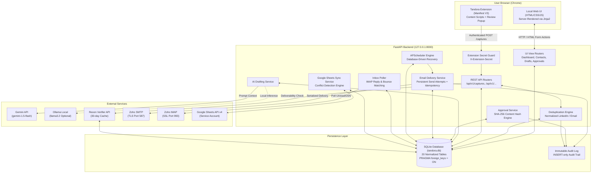
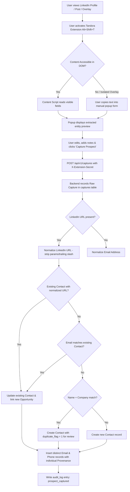
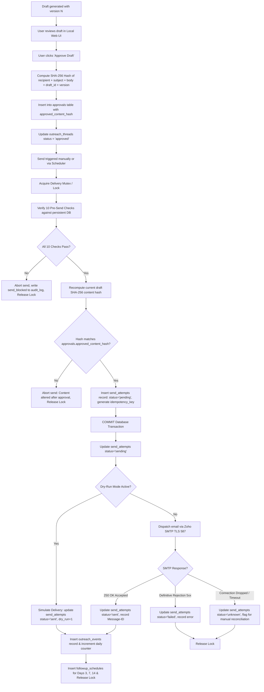

# Architecture — Tandora Lead Management & Outreach Application

## 1. System Overview

Tandora is a locally deployed, single-user application designed for high-precision prospect management and outreach on Windows 11.

The system consists of:

- **FastAPI Core Application**: A Python backend that serves both a RESTful API and a lightweight, server-rendered web management interface (using Jinja2 templates and vanilla HTML/CSS/JS).
- **SQLite Database**: The single, authoritative persistence engine managed via SQLAlchemy 2.x and Alembic migrations.
- **Chrome Extension (Manifest V3)**: A browser companion that captures prospect data from LinkedIn profiles, LinkedIn posts, company pages, job boards, and visible ContactOut/Apollo.io panels, submitting structured payloads to the local backend.
- **Persistent Scheduler**: A database-backed dispatch engine using APScheduler for executing follow-ups on days 3, 7, and 14, complete with startup recovery.
- **External Integration Connectors**:
  - *Gemini API* (primary) and *Ollama* (optional local) for AI draft generation.
  - *Reoon Email Verifier API* for deliverability checks with 30-day caching.
  - *Zoho Mail* (SMTP for sending with persistent send attempts; IMAP for reply/bounce tracking).
  - *Google Sheets API v4* for user-initiated bidirectional synchronization.

The application binds strictly to `127.0.0.1:8000`. No cloud infrastructure, containerization, or external network exposure is introduced.

---

## 2. Component Responsibilities

### 2.1 FastAPI Core & Local Web Interface

**Responsibilities**:
- Serves the local web management interface (Jinja2 templates + responsive CSS) accessible at `http://127.0.0.1:8000`.
- Exposes RESTful endpoints under `/api/v1/` for extension capture, third-party integrations, and automated operations.
- Enforces the shared extension authentication secret (`X-Extension-Secret`).
- Orchestrates business workflows across deduplication, verification, AI drafting, approval, sending, and synchronization.
- Manages database sessions, connection pooling, and SQLite foreign key pragmas.

### 2.2 Local Web Interface Views (Server-Rendered)

1. **Dashboard**: High-level metrics, daily sending quota utilization (today's count vs. 20 limit), global pause toggle status, and recent activity feed.
2. **Organizations / Companies**: List, search, detail view, suppression status, and associated opportunities/contacts.
3. **Opportunities / Prospects**: Track employment and freelance opportunities, statuses (`active`, `paused`, `closed`, `won`, `lost`), and linked decision-makers.
4. **Contacts**: Contact profiles, normalized LinkedIn URLs, titles, locations, notes, duplicate warning flags, and linked opportunities.
5. **Emails & Phone Numbers**: Individual records with full provenance (source: `ContactOut`, `Apollo`, `LinkedIn`, `manual`; source URL, timestamp) and deliverability status.
6. **Email Verification**: Reoon verification trigger, cached results viewer, credit consumption stats, and manual catch-all approval toggle.
7. **Outreach Threads & Drafts**: Thread history, selected email address, draft generator, version history viewer, side-by-side diffs, and editor.
8. **Approval Center**: Content review, SHA-256 approval content hash generation, approval/rejection actions, and approval revocation.
9. **Send Attempts & Outbound Queue**: Persistent send attempt lifecycle viewer (`pending`, `sending`, `sent`, `failed`, `unknown`), dry-run toggle, error logs, and manual reconciliation for unknown states.
10. **Suppression Management**: Person-level, address-level, and organization-level suppression lists with reason tracking and audit trail.
11. **Google Sheets Sync**: Manual sync trigger, diff inspection, conflict resolution table, and sync history.

### 2.3 Chrome Extension (Manifest V3)

**Responsibilities**:
- **Supported Page Types**:
  - LinkedIn individual profile pages (extracts full name, headline, current company, title, location, LinkedIn URL).
  - LinkedIn posts (extracts post author name, author LinkedIn URL, headline, post URL, post excerpt, timestamp, mentioned companies; keeps post author distinct from profile viewed).
  - LinkedIn company pages and job listings.
  - Arbitrary prospect websites and career pages.
  - Visible ContactOut and Apollo.io browser-extension overlays and panels (when rendered in the active DOM).
- **Manual Fallback**: Provides a clean paste-and-parse interface within the popup when third-party extension overlays are isolated in shadow DOM or inaccessible contexts.
- **Review Before Submit**: Displays all extracted data in an editable popup form allowing user review, correction, and annotation prior to persistence.
- **Provenance Tagging**: Tags each extracted email and phone with its detected source (`ContactOut`, `Apollo`, `LinkedIn`, `manual`).
- **Least-Privilege Security**: Requests only `activeTab`, `scripting`, and `storage`. Restricts network access exclusively to `http://127.0.0.1:8000/*`. Avoids `<all_urls>`.

### 2.4 SQLite Database

**Responsibilities**:
- Single source of truth for all application state.
- Enforces relational integrity with `PRAGMA foreign_keys = ON` on every connection.
- Stores 20 normalized tables covering organizations, opportunities, contacts, roles, emails, phones, captures, posts, threads, drafts, approvals, send attempts, events, schedules, replies, bounces, sync state, and audit logs.
- Stores immutable event records in `audit_log` (INSERT-only).

### 2.5 Approval & Content Hashing Service

**Responsibilities**:
- Guarantees that only the exact content reviewed and approved by the user can be dispatched.
- Generates a SHA-256 hash over: `recipient_address + "\n" + subject + "\n" + body + "\n" + str(draft_id) + "\n" + str(version)`.
- Persists the hash in `approvals.approved_content_hash`.
- Validates the hash immediately prior to delivery. Rejects sending if draft content or recipient has been modified since approval.
- Enforces approval invalidation: any draft edit creates a new version (`is_edited = 1`) requiring fresh approval.

### 2.6 Email Delivery & Persistent Send Attempt Service

**Responsibilities**:
- Executes the persistent send attempt lifecycle:
  $$\text{Pre-Send Checks} \rightarrow \text{Persist 'pending' Attempt} \rightarrow \text{Commit DB} \rightarrow \text{Transition 'sending'} \rightarrow \text{Dispatch SMTP} \rightarrow \text{Commit 'sent'/'failed'/'unknown'}$$
- Prevents duplicate sends using unique idempotency keys per thread action.
- Serializes send operations in Python using an in-process asyncio/threading lock to eliminate concurrency race conditions on daily quotas.
- Manages the daily sending quota (maximum 20 emails globally) based on persistent records in `outreach_events`.
- Enforces dry-run mode (`dry_run = true` by default) for zero-risk pipeline validation.
- Flags delivery anomalies as `unknown` when SMTP connections drop mid-flight; disables automated resending on `unknown` attempts and mandates manual reconciliation.

### 2.7 Inbox Monitoring & Suppression Service

**Responsibilities**:
- Polls Zoho IMAP on a background schedule (e.g., every 15 minutes).
- Correlates incoming messages to outbound outreach threads via `In-Reply-To` and `References` headers.
- Automatically transitions thread status to `replied` and cancels/suppresses all pending follow-up schedules.
- Parses Delivery Status Notifications (DSNs), registers hard bounces, and flags the corresponding email address as suppressed.
- Enforces multi-level suppression (person, address, organization).

### 2.8 Database-Driven Scheduler & Recovery

**Responsibilities**:
- Follow-up dispatch on days 3, 7, and 14.
- Follow-up records stored authoritatively in SQLite (`followup_schedules`).
- On application restart:
  1. Queries SQLite for overdue or pending schedules.
  2. Verifies thread eligibility (not replied, bounced, or suppressed).
  3. Checks approval record and re-validates SHA-256 content hash.
  4. Verifies daily quota and global pause state.
  5. Schedules tasks safely with duplicate-dispatch guards.

### 2.9 AI Provider Integration (Gemini & Ollama)

**Responsibilities**:
- Generates tailored outreach drafts using entity context (organization description, opportunity requirements, contact background, notes, post content).
- Implements `LLMProvider` protocol interface for zero-code-change switching between cloud Gemini (`gemini-1.5-flash`) and local Ollama (`llama3.2`).
- Validates structured output and prevents hallucinated placeholders.

### 2.10 Reoon Email Verifier Integration

**Responsibilities**:
- Calls Reoon API (`mode=power`) to verify address deliverability.
- Caches verification results for 30 days to protect API credits.
- Gating: `safe` addresses proceed; `catch-all` addresses are held for explicit user approval (`catch_all_approved = 1`); `invalid`/`unknown`/`disposable` are rejected.

### 2.11 Google Sheets Synchronization

**Responsibilities**:
- User-triggered manual bidirectional synchronization via Google Sheets API v4.
- Matches records via stable UUID `external_id`.
- Detects field-level conflicts and stages them for manual user resolution.
- Enforces strict idempotency.

---

## 3. Technology Stack

| Layer | Technology | Version | Justification |
|-------|------------|---------|---------------|
| Backend Runtime | Python | 3.12+ | Type safety, modern async runtime, robust email/AI ecosystem |
| Web & API Framework | FastAPI | 0.110+ | High-performance ASGI framework, automatic validation, native Jinja2 support |
| Template Engine | Jinja2 | 3.1+ | Lightweight server-rendered local UI without frontend build complexity |
| ORM | SQLAlchemy | 2.0+ | Modern 2.0-style syntax, robust SQLite transaction & relationship handling |
| Schema Migrations | Alembic | 1.13+ | Version-controlled, reproducible database migrations |
| Persistence | SQLite | 3.40+ | Zero-cost, serverless, atomic transactions, embedded local file |
| Scheduling | APScheduler | 3.10+ | Lightweight in-process job scheduling backed by SQLite records |
| Browser Extension | Chrome Manifest V3 | MV3 | Modern standard, isolated service workers, least-privilege permissions |
| AI Drafting (Primary) | Gemini API | 1.5 Flash | Fast, free tier available, excellent structured output compliance |
| AI Drafting (Optional) | Ollama | Local | Fully offline, zero-cost fallback for local LLM execution |
| Email Deliverability | Reoon API | v1 | Reliable deliverability verification, catch-all detection, credit efficiency |
| Email Delivery | Zoho SMTP | TLS 587 | Standard business email transport with STARTTLS encryption |
| Inbox Polling | Zoho IMAP | SSL 993 | Reliable inbox inspection, header analysis, DSN bounce detection |
| External Sheet Sync | Google Sheets API | v4 | Universal tabular access and spreadsheet backup interface |
| Configuration | python-dotenv | 1.0+ | Secure local environment variable isolation; gitignored `.env` |
| Testing | pytest / pytest-asyncio | 8.0+ | Comprehensive automated test coverage with in-memory SQLite and service mocks |

---

## 4. Mermaid Component Architecture



---

## 5. Mermaid Data Flow Diagrams

### 5.1 Prospect Capture & Deduplication Flow



### 5.2 Approval & Reliable Send Attempt Flow



---

## 6. Deployment Architecture

The application runs locally on a Windows 11 machine:

```
Windows 11 Laptop
├── Python 3.12 Virtual Environment (.venv)
│   ├── uvicorn app.main:app --host 127.0.0.1 --port 8000
│   ├── FastAPI (REST API + Jinja2 HTML Views)
│   ├── APScheduler (In-process background runner with SQLite recovery)
│   └── Integrations (Gemini, Reoon, Zoho, Google Sheets)
├── Local SQLite Database File (./data/tandora.db)
├── Environment Configuration (.env, gitignored)
├── Chrome Extension (Loaded unpacked from ./extension in Google Chrome)
└── Ollama Instance (Optional, http://127.0.0.1:11434)
```

---

## 7. Key Architectural Decisions and Rationales

| Decision | Choice | Rationale |
|----------|--------|-----------|
| Local UI Architecture | FastAPI + Jinja2 Server-Rendered HTML | Eliminates node_modules, build chains, and SPA complexity while delivering a full management UI in Stage 1. |
| Persistence Engine | SQLite + WAL mode | Zero infrastructure cost, instant backups, handles single-user volume easily, zero network latency. |
| Approval Content Integrity | SHA-256 approved_content_hash | Mathematically guarantees that the message sent is bit-for-bit identical to what the user reviewed. |
| Delivery Reliability | Multi-step persistent `send_attempts` lifecycle | Eliminates duplicate sends on process crashes; SMTP and SQLite cannot form a 2-phase commit, so lifecycle staging isolates failures. |
| Concurrency Control | In-process delivery serialization lock | Prevents concurrent follow-up triggers or API requests from exceeding the daily 20-message quota. |
| Deduplication Strategy | Normalized LinkedIn URL $\rightarrow$ Email $\rightarrow$ Name+Company Flag | Deterministic matching without accidentally conflating distinct individuals who share identical names. |
| Third-Party Overlay Extraction | Visible DOM reading + Manual Form Fallback | Respects browser boundaries and compliance rules without fragile scraping or undocumented API reverse-engineering. |
| Scheduler State | SQLite `followup_schedules` authoritative | Survives laptop sleeps, restarts, and crashes; APScheduler merely polls the persistent schedule. |
