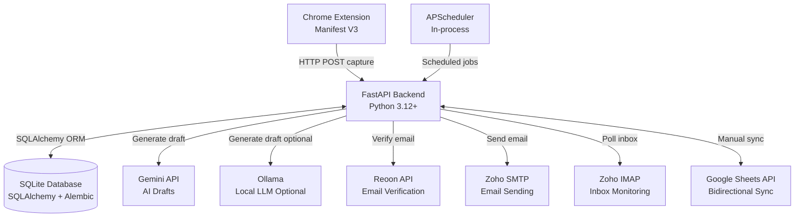
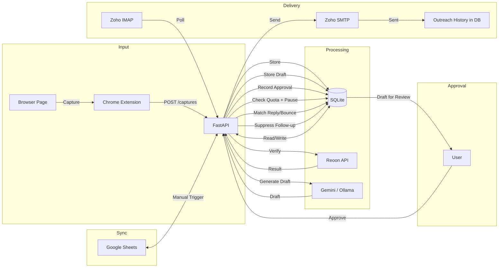

# Architecture — Tandora Lead Management & Outreach Application

## 1. System Overview

Tandora is a locally-deployed, single-user application. The system consists of:

- A Python/FastAPI backend that owns all business logic, data persistence, scheduling, and external integrations.
- A Chrome Extension (Manifest V3) that captures lead data from browser pages and submits it to the backend.
- A SQLite database for all persistent state.
- A lightweight persistent scheduler for follow-up sending.
- A set of external service integrations: Gemini API, Reoon, Zoho SMTP/IMAP, and Google Sheets API.

The application runs entirely on the user's Windows 11 laptop. There is no cloud hosting, no public-facing server, and no authentication layer in the initial version.

---

## 2. Component Responsibilities

### 2.1 FastAPI Backend

**Responsibility**: Central orchestrator and API server.

- Exposes a RESTful HTTP API consumed by the Chrome Extension and any future front-end clients.
- Manages all database operations via SQLAlchemy.
- Applies migrations via Alembic.
- Calls external services: Gemini API, Reoon API, Zoho SMTP/IMAP, Google Sheets API.
- Enforces the approval gate: no email is ever sent without a database-recorded approval.
- Enforces the daily sending limit and global pause.
- Triggers draft generation, verification, and synchronization.
- Writes audit log entries for every significant event.

### 2.2 SQLite Database

**Responsibility**: Single source of truth for all application state.

- Stores companies, opportunities, contacts, roles, email addresses.
- Stores email verification results and history.
- Stores draft versions and approval records.
- Stores outreach threads, sending history, reply/bounce records.
- Stores follow-up schedules and suppression records.
- Stores audit log entries.
- Stores Google Sheets sync state (last-sync timestamps, checksums).
- Stores application configuration (sending limit, pause state, provider settings).

### 2.3 Chrome Extension

**Responsibility**: Browser-side data capture.

- Runs as a Manifest V3 extension with a background service worker.
- Provides a popup UI for capturing: current page URL, page title, selected text, user-annotated notes.
- Sends captured data to the local FastAPI backend via authenticated HTTP requests.
- Supports a keyboard shortcut for quick capture.
- Does not store data locally; the backend is the only store.

### 2.4 Scheduler

**Responsibility**: Time-based follow-up dispatch.

- Implemented using APScheduler (or equivalent lightweight Python scheduler).
- Runs as a background thread within the FastAPI process.
- Checks for follow-ups due today that have been approved and not yet sent.
- Respects the global pause toggle.
- Respects the daily sending limit.
- Does not send anything that lacks an approval record.

### 2.5 Gemini API Integration

**Responsibility**: AI-powered draft generation (primary provider).

- Called when the user requests a draft for a contact/opportunity pair.
- Receives company context, opportunity details, contact information, and a prompt template.
- Returns a subject line and email body.
- Errors are handled gracefully; the user is informed if generation fails.

### 2.6 Ollama Integration

**Responsibility**: Optional local LLM provider.

- Activated by changing the LLM provider setting in configuration.
- Implements the same provider interface as the Gemini integration.
- Called with the same prompt structure.
- Useful for offline use or cost reduction.

### 2.7 Reoon Email Verifier Integration

**Responsibility**: Email address verification before outreach.

- Called when the user requests verification of one or more email addresses.
- Results (safe, catch-all, invalid, unknown) are stored with timestamps.
- API credit consumption is tracked.
- Catch-all results are flagged; they require explicit approval before use.
- Results are cached to avoid re-verifying the same address unnecessarily.

### 2.8 Zoho SMTP Integration

**Responsibility**: Outbound email delivery.

- Sends approved email drafts.
- Enforces the 20-message-per-day global limit before sending.
- Checks the global pause state before sending.
- Records each sent message in the outreach history.
- Writes an audit log entry per sent message.

### 2.9 Zoho IMAP Integration

**Responsibility**: Inbound email monitoring.

- Polls the inbox on a schedule (e.g., every 15 minutes).
- Matches incoming messages to outbound outreach threads using Message-ID and In-Reply-To headers.
- Records replies and links them to the originating thread.
- Detects bounce messages and flags the associated contact/email address.
- Suppresses pending follow-ups when a reply is detected.

### 2.10 Google Sheets Integration

**Responsibility**: Manual bidirectional data synchronization.

- Triggered by the user via API endpoint, not automatically.
- Exports: companies, contacts, opportunities, outreach status to a configured Google Sheets spreadsheet.
- Imports: updates from the spreadsheet back into the SQLite database.
- Conflict detection: if a record has been modified in both Sheets and the database since the last sync, the conflict is surfaced to the user.
- Idempotent: running sync twice must not create duplicate records.

---

## 3. Technology Stack

| Layer | Technology | Justification |
|-------|-----------|---------------|
| Backend language | Python 3.12+ | Strong ecosystem for API, AI, and email integration |
| API framework | FastAPI | Async-capable, Pydantic-integrated, well-documented |
| Database | SQLite | Zero-cost, no-server, sufficient for single-user volume |
| ORM | SQLAlchemy 2.x | Industry standard, supports SQLite, type-safe |
| Migrations | Alembic | Pairs with SQLAlchemy, supports incremental schema changes |
| Scheduler | APScheduler | Lightweight, persistent, runs in-process |
| Browser extension | Chrome Extension Manifest V3 | Current standard, JavaScript, runs in Chrome |
| AI provider (primary) | Gemini API | Free tier available, strong quality |
| AI provider (optional) | Ollama | Local inference, no cost, offline capable |
| Email verification | Reoon API | Agreed requirement |
| Email outbound | Zoho SMTP | Agreed provider |
| Email inbound | Zoho IMAP | Agreed provider |
| Spreadsheet sync | Google Sheets API v4 | Agreed requirement |
| Configuration | Python dotenv / environment variables | No secrets in code |
| Testing | pytest | Standard Python testing framework |

---

## 4. Component Interactions

```
Chrome Extension
      │
      │  HTTP POST (capture data)
      ▼
FastAPI Backend ──── SQLAlchemy ──── SQLite DB
      │
      ├── Gemini API (draft generation)
      ├── Ollama (optional draft generation)
      ├── Reoon API (email verification)
      ├── Zoho SMTP (send emails)
      ├── Zoho IMAP (monitor replies/bounces)
      ├── Google Sheets API (bidirectional sync)
      └── APScheduler (follow-up dispatch, in-process)
```

---

## 5. Data Flow

### 5.1 Employment Outreach Flow

1. User browses a job listing in Chrome.
2. Chrome Extension captures: URL, job title, company name, job description excerpt.
3. Extension POSTs capture to FastAPI `/captures` endpoint.
4. Backend creates or links a Company record and creates an Opportunity record.
5. User adds contacts (recruiters, hiring managers) via API or Sheets sync.
6. User verifies contact email addresses via Reoon.
7. Backend stores verification result. If `catch-all`, user must explicitly approve.
8. User requests a draft for a selected contact + opportunity pair.
9. Backend calls Gemini API (or Ollama) with context. Stores draft version 1.
10. User reviews the draft in the UI/Sheets. Approves it.
11. Backend records approval and schedules sending.
12. Scheduler (or immediate send) dispatches via Zoho SMTP. Daily limit checked.
13. Backend records the sent message in outreach history. Writes audit log.
14. IMAP poller detects a reply. Links it to the thread. Suppresses pending follow-ups.
15. If no reply by day 3, scheduler triggers follow-up draft generation.
16. User approves follow-up. It is sent on day 3 (or later if paused).

### 5.2 Freelance Acquisition Flow

Identical to 5.1, except the Opportunity type is `freelance_prospect` and the email context emphasizes service capabilities rather than job application content.

### 5.3 Google Sheets Sync Flow

1. User triggers sync via API endpoint.
2. Backend reads last-sync state from the database.
3. Backend fetches current Sheets data.
4. Backend compares Sheets rows with database records (by stable ID or external key).
5. For new rows in Sheets: create records in database.
6. For new records in database: create rows in Sheets.
7. For rows changed in both: record conflict, surface to user.
8. For rows changed in one source only: apply the change to the other.
9. Update last-sync timestamps. Write audit log entry.

---

## 6. External Integrations

| Integration | Protocol | Auth Method | Direction |
|-------------|----------|-------------|-----------|
| Gemini API | HTTPS/REST | API Key (env var) | Outbound |
| Ollama | HTTP/REST | None (local) | Outbound (local) |
| Reoon API | HTTPS/REST | API Key (env var) | Outbound |
| Zoho SMTP | SMTP/TLS | App password (env var) | Outbound |
| Zoho IMAP | IMAP/TLS | App password (env var) | Inbound (polling) |
| Google Sheets API | HTTPS/REST | OAuth2 service account or user credentials | Bidirectional |

**All API credentials must be stored in environment variables or a local `.env` file. They must never appear in source code or be committed to version control.**

---

## 7. Mermaid Component Diagram



---

## 8. Mermaid Data Flow Diagram



---

## 9. Deployment Architecture

The application runs on a single Windows 11 machine:

```
Windows 11 Laptop
├── Python 3.12 (venv)
│   ├── FastAPI (uvicorn, port 8000)
│   ├── APScheduler (in-process thread)
│   └── All integrations as Python modules
├── SQLite database file (./data/tandora.db)
├── .env file (credentials, never committed)
├── Chrome Extension (loaded unpacked in Chrome)
└── Ollama (optional, separate process)
```

The FastAPI server is started manually or via a Windows startup script. No Docker, no cloud infrastructure, no reverse proxy required initially.

---

## 10. Architectural Decisions and Rationale

| Decision | Choice | Rationale |
|----------|--------|-----------|
| Database | SQLite | Zero cost, no server, single-user volume is well within SQLite's capabilities |
| In-process scheduler | APScheduler | Avoids a separate process; sufficient for single-user scheduling volume |
| No auth layer | Localhost-only binding | Single-user, local-only; adding auth when multi-user is needed |
| Provider abstraction for LLM | Interface pattern | Allows Gemini/Ollama swap without code changes |
| Manual sync trigger | User-initiated | Prevents silent data loss from automatic conflict resolution |
| SQLAlchemy + Alembic | Standard ORM stack | Enables schema evolution without data loss |
| No Supabase | SQLite retained | Agreed constraint; local-first, zero-cost |
