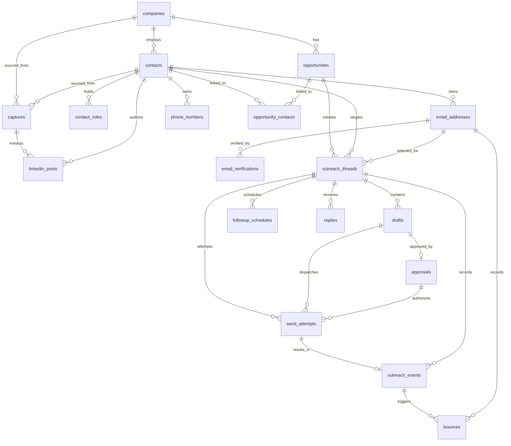

# Database Schema — Tandora Lead Management & Outreach Application

## 1. Overview

All application data is stored in a single SQLite database file (`./data/tandora.db`). The schema is managed by Alembic for version-controlled, lossless migrations.

The database is the single source of truth for all prospect records, verification statuses, AI drafts, approvals, send attempts, follow-up schedules, and audit trails.

SQLite foreign key constraints are strictly enforced across all sessions:
```sql
PRAGMA foreign_keys = ON;
PRAGMA journal_mode = WAL;
```

---

## 2. Entity Summary (21 Tables)

| Entity | Table | Purpose |
|--------|-------|---------|
| Organization / Company | `companies` | Companies, employers, and freelance prospect organizations |
| Opportunity | `opportunities` | Specific jobs or freelance service opportunities |
| Contact | `contacts` | Individual prospects and decision-makers |
| Contact Role | `contact_roles` | Normalized roles held by contacts (e.g., CTO, Founder, Recruiter) |
| Email Address | `email_addresses` | Contact email addresses with individual provenance tracking |
| Phone Number | `phone_numbers` | Contact phone numbers with individual provenance tracking |
| Email Verification | `email_verifications` | Reoon deliverability verification results (30-day cache) |
| Raw Capture | `captures` | Full structured payloads captured from extension or web |
| LinkedIn Post | `linkedin_posts` | Post content and author context captured from LinkedIn feeds |
| Opportunity Contact | `opportunity_contacts` | Many-to-many link between opportunities and relevant contacts |
| Outreach Thread | `outreach_threads` | Unique outreach engagement per (opportunity, contact, selected_email) |
| Draft | `drafts` | Immutable versioned email drafts |
| Approval | `approvals` | Explicit user approvals with SHA-256 approved content hash |
| Send Attempt | `send_attempts` | Persistent lifecycle state machine for outbound delivery attempts |
| Outreach Event | `outreach_events` | Historical record of successfully dispatched emails |
| Follow-up Schedule | `followup_schedules` | Persistent database schedule for Days 3, 7, and 14 follow-ups |
| Reply | `replies` | Inbound replies detected and correlated via Zoho IMAP |
| Bounce | `bounces` | Hard/soft bounce events detected via IMAP delivery status notifications |
| Sheets Sync State | `sheets_sync_state` | Checksums and timestamps for Google Sheets bidirectional sync |
| Audit Log | `audit_log` | Immutable append-only operational audit trail |
| App Config | `app_config` | Persistent application configuration key-value store |

---

## 3. Table Definitions

### 3.1 `companies` (Organizations)

| Column | Type | Constraints | Description |
|--------|------|-------------|-------------|
| `id` | INTEGER | PK, AUTOINCREMENT | Internal primary key |
| `external_id` | TEXT | UNIQUE, NOT NULL | Stable UUIDv4 identifier for Sheets sync |
| `name` | TEXT | NOT NULL | Organization name |
| `website` | TEXT | | Cleaned website URL |
| `industry` | TEXT | | Industry classification |
| `description` | TEXT | | Brief description or notes |
| `type` | TEXT | NOT NULL, DEFAULT 'employer' | `employer` or `freelance_prospect` |
| `source_url` | TEXT | | URL where company was first discovered |
| `suppressed` | INTEGER | NOT NULL, DEFAULT 0 | 1 = Organization-level suppression active |
| `suppressed_reason` | TEXT | | Reason for organization suppression |
| `suppressed_at` | DATETIME | | Timestamp of suppression |
| `created_at` | DATETIME | NOT NULL, DEFAULT now | Creation timestamp |
| `updated_at` | DATETIME | NOT NULL, DEFAULT now | Last modification timestamp |
| `sheets_row_id` | TEXT | | Associated Google Sheets row reference |
| `sheets_last_synced_at` | DATETIME | | Last successful sync timestamp |

**Indexes**: `idx_companies_name`, `idx_companies_external_id`, `idx_companies_suppressed`

---

### 3.2 `opportunities`

| Column | Type | Constraints | Description |
|--------|------|-------------|-------------|
| `id` | INTEGER | PK, AUTOINCREMENT | Internal primary key |
| `external_id` | TEXT | UNIQUE, NOT NULL | Stable UUIDv4 identifier |
| `company_id` | INTEGER | FK $\rightarrow$ companies.id, NOT NULL | Associated organization |
| `type` | TEXT | NOT NULL | `employment` or `freelance_prospect` |
| `title` | TEXT | NOT NULL | Opportunity or job title |
| `description` | TEXT | | Job description or service scope requirements |
| `source_url` | TEXT | | Posting or announcement URL |
| `status` | TEXT | NOT NULL, DEFAULT 'active' | `active`, `paused`, `closed`, `won`, `lost` |
| `created_at` | DATETIME | NOT NULL, DEFAULT now | Creation timestamp |
| `updated_at` | DATETIME | NOT NULL, DEFAULT now | Last modification timestamp |
| `sheets_row_id` | TEXT | | Sheets row reference |
| `sheets_last_synced_at` | DATETIME | | Last sync timestamp |

**Indexes**: `idx_opportunities_company_id`, `idx_opportunities_status`

---

### 3.3 `contacts`

| Column | Type | Constraints | Description |
|--------|------|-------------|-------------|
| `id` | INTEGER | PK, AUTOINCREMENT | Internal primary key |
| `external_id` | TEXT | UNIQUE, NOT NULL | Stable UUIDv4 identifier |
| `company_id` | INTEGER | FK $\rightarrow$ companies.id | Current organization (nullable for unassigned leads) |
| `first_name` | TEXT | NOT NULL | First name |
| `last_name` | TEXT | | Last name |
| `full_name` | TEXT | NOT NULL | Computed or extracted full name |
| `headline` | TEXT | | Professional headline / title summary |
| `location` | TEXT | | Geographical location |
| `linkedin_url` | TEXT | | Original LinkedIn profile URL |
| `normalized_linkedin_url` | TEXT | UNIQUE | Canonicalized LinkedIn URL (strip params, slashes, lowercase) |
| `notes` | TEXT | | User-annotated notes |
| `duplicate_flag` | INTEGER | NOT NULL, DEFAULT 0 | 1 = Potential duplicate flagged for manual review |
| `duplicate_of_contact_id` | INTEGER | FK $\rightarrow$ contacts.id | Target contact ID if flagged as potential duplicate |
| `suppressed` | INTEGER | NOT NULL, DEFAULT 0 | 1 = Person-level suppression active |
| `suppressed_reason` | TEXT | | Reason for contact suppression |
| `suppressed_at` | DATETIME | | Timestamp of contact suppression |
| `created_at` | DATETIME | NOT NULL, DEFAULT now | Creation timestamp |
| `updated_at` | DATETIME | NOT NULL, DEFAULT now | Last modification timestamp |
| `sheets_row_id` | TEXT | | Sheets row reference |
| `sheets_last_synced_at` | DATETIME | | Last sync timestamp |

**Indexes**: `idx_contacts_normalized_linkedin`, `idx_contacts_company_id`, `idx_contacts_suppressed`, `idx_contacts_duplicate_flag`

---

### 3.4 `contact_roles`

| Column | Type | Constraints | Description |
|--------|------|-------------|-------------|
| `id` | INTEGER | PK, AUTOINCREMENT | Internal primary key |
| `contact_id` | INTEGER | FK $\rightarrow$ contacts.id, NOT NULL | Associated contact |
| `role` | TEXT | NOT NULL | Role designation (e.g., `CTO`, `Founder`, `Recruiter`) |
| `created_at` | DATETIME | NOT NULL, DEFAULT now | Creation timestamp |

**Unique Constraint**: `(contact_id, role)` — prevents duplicate role assignments.

---

### 3.5 `email_addresses`

| Column | Type | Constraints | Description |
|--------|------|-------------|-------------|
| `id` | INTEGER | PK, AUTOINCREMENT | Internal primary key |
| `external_id` | TEXT | UNIQUE, NOT NULL | Stable UUIDv4 identifier |
| `contact_id` | INTEGER | FK $\rightarrow$ contacts.id, NOT NULL | Associated contact |
| `address` | TEXT | NOT NULL | Normalized email address (lowercase, trimmed) |
| `is_primary` | INTEGER | NOT NULL, DEFAULT 0 | 1 = Primary outreach address for contact |
| `source` | TEXT | NOT NULL, DEFAULT 'manual' | Provenance: `ContactOut`, `Apollo`, `LinkedIn`, `manual`, `website` |
| `source_url` | TEXT | | URL where address was discovered |
| `captured_at` | DATETIME | NOT NULL, DEFAULT now | Timestamp when extracted |
| `suppressed` | INTEGER | NOT NULL, DEFAULT 0 | 1 = Address-level suppression active (bounced/opt-out) |
| `suppressed_reason` | TEXT | | Reason for address suppression |
| `suppressed_at` | DATETIME | | Timestamp of address suppression |
| `created_at` | DATETIME | NOT NULL, DEFAULT now | Record creation timestamp |
| `updated_at` | DATETIME | NOT NULL, DEFAULT now | Record update timestamp |

**Unique Constraint**: `address` — an email address maps to one contact.
**Indexes**: `idx_email_addresses_contact_id`, `idx_email_addresses_address`, `idx_email_addresses_suppressed`

---

### 3.6 `phone_numbers`

| Column | Type | Constraints | Description |
|--------|------|-------------|-------------|
| `id` | INTEGER | PK, AUTOINCREMENT | Internal primary key |
| `contact_id` | INTEGER | FK $\rightarrow$ contacts.id, NOT NULL | Associated contact |
| `number` | TEXT | NOT NULL | Phone number string |
| `type` | TEXT | NOT NULL, DEFAULT 'direct' | `work`, `mobile`, `direct`, `company`, `other` |
| `source` | TEXT | NOT NULL, DEFAULT 'manual' | Provenance: `ContactOut`, `Apollo`, `LinkedIn`, `manual` |
| `source_url` | TEXT | | URL where number was discovered |
| `captured_at` | DATETIME | NOT NULL, DEFAULT now | Extraction timestamp |
| `created_at` | DATETIME | NOT NULL, DEFAULT now | Creation timestamp |
| `updated_at` | DATETIME | NOT NULL, DEFAULT now | Update timestamp |

**Unique Constraint**: `(contact_id, number)`
**Indexes**: `idx_phone_numbers_contact_id`

---

### 3.7 `email_verifications`

| Column | Type | Constraints | Description |
|--------|------|-------------|-------------|
| `id` | INTEGER | PK, AUTOINCREMENT | Internal primary key |
| `email_address_id` | INTEGER | FK $\rightarrow$ email_addresses.id, NOT NULL | Verified address |
| `status` | TEXT | NOT NULL | `safe`, `catch-all`, `invalid`, `unknown`, `role_account`, `disposable` |
| `catch_all_approved` | INTEGER | NOT NULL, DEFAULT 0 | 1 = Explicit manual approval granted by user |
| `catch_all_approved_at` | DATETIME | | Timestamp of catch-all approval |
| `reoon_response` | TEXT | | Raw JSON response payload from Reoon API |
| `credits_used` | INTEGER | NOT NULL, DEFAULT 1 | Reoon API credits consumed |
| `verified_at` | DATETIME | NOT NULL | Verification execution timestamp |
| `expires_at` | DATETIME | NOT NULL | Cache expiry timestamp (verified_at + 30 days) |

**Indexes**: `idx_email_verifications_address_id`, `idx_email_verifications_status`, `idx_email_verifications_expires`

---

### 3.8 `captures` (Raw Extension & Web Ingestion)

| Column | Type | Constraints | Description |
|--------|------|-------------|-------------|
| `id` | INTEGER | PK, AUTOINCREMENT | Internal primary key |
| `capture_type` | TEXT | NOT NULL | `linkedin_profile`, `linkedin_post`, `linkedin_company`, `job_listing`, `generic_web`, `contactout_apollo_overlay` |
| `page_type` | TEXT | NOT NULL | Extracted page classification |
| `source_url` | TEXT | NOT NULL | URL of captured tab |
| `source_title` | TEXT | | Page title |
| `selected_text` | TEXT | | Text selected by user on page |
| `user_notes` | TEXT | | Notes added in extension popup |
| `raw_payload` | TEXT | NOT NULL | Complete JSON payload extracted |
| `company_id` | INTEGER | FK $\rightarrow$ companies.id | Linked organization (if created/matched) |
| `contact_id` | INTEGER | FK $\rightarrow$ contacts.id | Linked contact (if created/matched) |
| `opportunity_id` | INTEGER | FK $\rightarrow$ opportunities.id | Linked opportunity (if created/matched) |
| `captured_at` | DATETIME | NOT NULL | Client-side capture timestamp |
| `created_at` | DATETIME | NOT NULL, DEFAULT now | Server receipt timestamp |

**Indexes**: `idx_captures_source_url`, `idx_captures_contact_id`

---

### 3.9 `linkedin_posts`

| Column | Type | Constraints | Description |
|--------|------|-------------|-------------|
| `id` | INTEGER | PK, AUTOINCREMENT | Internal primary key |
| `capture_id` | INTEGER | FK $\rightarrow$ captures.id, NOT NULL | Associated capture record |
| `author_name` | TEXT | NOT NULL | Post author's name |
| `author_linkedin_url` | TEXT | | Post author's LinkedIn URL |
| `author_headline` | TEXT | | Post author's headline / role |
| `post_url` | TEXT | NOT NULL | Canonical URL of the post |
| `post_text` | TEXT | NOT NULL | Text body or visible excerpt of the post |
| `post_timestamp` | TEXT | | Relative or absolute post timestamp string |
| `company_mentioned` | TEXT | | Company or organization identified in post |
| `author_contact_id` | INTEGER | FK $\rightarrow$ contacts.id | Linked contact if author was added as a decision-maker |
| `opportunity_id` | INTEGER | FK $\rightarrow$ opportunities.id | Linked opportunity if post represents a job/freelance lead |
| `created_at` | DATETIME | NOT NULL, DEFAULT now | Creation timestamp |

**Indexes**: `idx_linkedin_posts_post_url`, `idx_linkedin_posts_author_contact`

---

### 3.10 `opportunity_contacts`

| Column | Type | Constraints | Description |
|--------|------|-------------|-------------|
| `id` | INTEGER | PK, AUTOINCREMENT | Internal primary key |
| `opportunity_id` | INTEGER | FK $\rightarrow$ opportunities.id, NOT NULL | Opportunity reference |
| `contact_id` | INTEGER | FK $\rightarrow$ contacts.id, NOT NULL | Contact reference |
| `created_at` | DATETIME | NOT NULL, DEFAULT now | Creation timestamp |

**Unique Constraint**: `(opportunity_id, contact_id)`

---

### 3.11 `outreach_threads`

| Column | Type | Constraints | Description |
|--------|------|-------------|-------------|
| `id` | INTEGER | PK, AUTOINCREMENT | Internal primary key |
| `external_id` | TEXT | UNIQUE, NOT NULL | Stable UUIDv4 identifier |
| `opportunity_id` | INTEGER | FK $\rightarrow$ opportunities.id, NOT NULL | Opportunity reference |
| `contact_id` | INTEGER | FK $\rightarrow$ contacts.id, NOT NULL | Target contact |
| `selected_email_address_id` | INTEGER | FK $\rightarrow$ email_addresses.id, NOT NULL | The single locked email address for this thread |
| `status` | TEXT | NOT NULL, DEFAULT 'draft' | `draft`, `approved`, `sending`, `sent`, `replied`, `bounced`, `suppressed`, `closed` |
| `created_at` | DATETIME | NOT NULL, DEFAULT now | Creation timestamp |
| `updated_at` | DATETIME | NOT NULL, DEFAULT now | Modification timestamp |

**Unique Constraint**: `(opportunity_id, contact_id)` — exactly one thread per person per opportunity.
**Indexes**: `idx_outreach_threads_status`, `idx_outreach_threads_contact_id`

---

### 3.12 `drafts`

| Column | Type | Constraints | Description |
|--------|------|-------------|-------------|
| `id` | INTEGER | PK, AUTOINCREMENT | Internal primary key |
| `outreach_thread_id` | INTEGER | FK $\rightarrow$ outreach_threads.id, NOT NULL | Parent outreach thread |
| `version` | INTEGER | NOT NULL | Sequential version number (1, 2, ...) |
| `draft_type` | TEXT | NOT NULL | `initial` or `followup` |
| `followup_number` | INTEGER | | 1, 2, or 3 (for follow-ups) |
| `subject` | TEXT | NOT NULL | Email subject line |
| `body` | TEXT | NOT NULL | Email body text |
| `llm_provider` | TEXT | | `gemini` or `ollama` |
| `llm_model` | TEXT | | LLM model identifier (e.g., `gemini-3.5-flash-lite`) |
| `generation_prompt` | TEXT | | Prompt used for generation (audit context) |
| `is_edited` | INTEGER | NOT NULL, DEFAULT 0 | 1 = Draft was manually edited by user |
| `created_at` | DATETIME | NOT NULL, DEFAULT now | Creation timestamp |

**Unique Constraint**: `(outreach_thread_id, draft_type, followup_number, version)`
**Indexes**: `idx_drafts_thread_version`

---

### 3.13 `approvals`

| Column | Type | Constraints | Description |
|--------|------|-------------|-------------|
| `id` | INTEGER | PK, AUTOINCREMENT | Internal primary key |
| `draft_id` | INTEGER | FK $\rightarrow$ drafts.id, NOT NULL, UNIQUE | Approved draft version |
| `outreach_thread_id` | INTEGER | FK $\rightarrow$ outreach_threads.id, NOT NULL | Associated outreach thread |
| `approved_content_hash` | TEXT | NOT NULL | SHA-256 hash of recipient + subject + body + draft_id + version |
| `recipient_address` | TEXT | NOT NULL | Recipient address at time of approval |
| `subject_snapshot` | TEXT | NOT NULL | Exact subject approved |
| `body_snapshot` | TEXT | NOT NULL | Exact body approved |
| `approved_at` | DATETIME | NOT NULL | Timestamp of approval |
| `notes` | TEXT | | Optional reviewer notes |

**Rule**: If a draft is edited or regenerated, a new draft version is created. The old approval references the prior version and is invalid for the new draft version.

---

### 3.14 `send_attempts`

| Column | Type | Constraints | Description |
|--------|------|-------------|-------------|
| `id` | INTEGER | PK, AUTOINCREMENT | Internal primary key |
| `outreach_thread_id` | INTEGER | FK $\rightarrow$ outreach_threads.id, NOT NULL | Outreach thread reference |
| `draft_id` | INTEGER | FK $\rightarrow$ drafts.id, NOT NULL | Approved draft version |
| `approval_id` | INTEGER | FK $\rightarrow$ approvals.id, NOT NULL | Approval record reference |
| `idempotency_key` | TEXT | UNIQUE, NOT NULL | Unique hash/UUID to prevent duplicate execution |
| `status` | TEXT | NOT NULL, DEFAULT 'pending' | `pending`, `sending`, `sent`, `failed`, `unknown` |
| `attempt_number` | INTEGER | NOT NULL, DEFAULT 1 | Attempt counter |
| `recipient_address` | TEXT | NOT NULL | Destination email address |
| `message_id` | TEXT | | SMTP Message-ID if accepted |
| `error_message` | TEXT | | Error details if failed or unknown |
| `smtp_response` | TEXT | | Raw response from SMTP server |
| `dry_run` | INTEGER | NOT NULL, DEFAULT 0 | 1 = Simulated dispatch (dry-run mode) |
| `created_at` | DATETIME | NOT NULL, DEFAULT now | Record insertion timestamp |
| `started_at` | DATETIME | | Timestamp SMTP socket was opened |
| `completed_at` | DATETIME | | Timestamp final status was recorded |

**Indexes**: `idx_send_attempts_idempotency`, `idx_send_attempts_thread_id`, `idx_send_attempts_status`

---

### 3.15 `outreach_events`

| Column | Type | Constraints | Description |
|--------|------|-------------|-------------|
| `id` | INTEGER | PK, AUTOINCREMENT | Internal primary key |
| `outreach_thread_id` | INTEGER | FK $\rightarrow$ outreach_threads.id, NOT NULL | Outreach thread reference |
| `draft_id` | INTEGER | FK $\rightarrow$ drafts.id, NOT NULL | Sent draft version |
| `approval_id` | INTEGER | FK $\rightarrow$ approvals.id, NOT NULL | Validated approval reference |
| `send_attempt_id` | INTEGER | FK $\rightarrow$ send_attempts.id, NOT NULL | Completed send attempt |
| `event_type` | TEXT | NOT NULL | `initial` or `followup` |
| `followup_number` | INTEGER | | 1, 2, or 3 |
| `sent_at` | DATETIME | NOT NULL | Successful dispatch timestamp |
| `message_id` | TEXT | UNIQUE | SMTP Message-ID header value |
| `recipient_address` | TEXT | NOT NULL | Sent destination address |
| `smtp_response` | TEXT | | Server response code |
| `dry_run` | INTEGER | NOT NULL, DEFAULT 0 | 1 = Dispatched in dry-run mode |

**Indexes**: `idx_outreach_events_thread_id`, `idx_outreach_events_message_id`, `idx_outreach_events_sent_at`

---

### 3.16 `followup_schedules`

| Column | Type | Constraints | Description |
|--------|------|-------------|-------------|
| `id` | INTEGER | PK, AUTOINCREMENT | Internal primary key |
| `outreach_thread_id` | INTEGER | FK $\rightarrow$ outreach_threads.id, NOT NULL | Outreach thread reference |
| `followup_number` | INTEGER | NOT NULL | 1, 2, or 3 |
| `scheduled_date` | DATE | NOT NULL | Calendar date follow-up is due |
| `status` | TEXT | NOT NULL, DEFAULT 'pending' | `pending`, `approved`, `sent`, `suppressed`, `cancelled` |
| `suppressed_reason` | TEXT | | Reason for suppression (e.g., `reply_received`) |
| `suppressed_at` | DATETIME | | Timestamp of suppression |
| `created_at` | DATETIME | NOT NULL, DEFAULT now | Creation timestamp |
| `updated_at` | DATETIME | NOT NULL, DEFAULT now | Modification timestamp |

**Unique Constraint**: `(outreach_thread_id, followup_number)`
**Indexes**: `idx_followup_schedules_due`, `idx_followup_schedules_thread`

---

### 3.17 `replies`

| Column | Type | Constraints | Description |
|--------|------|-------------|-------------|
| `id` | INTEGER | PK, AUTOINCREMENT | Internal primary key |
| `outreach_thread_id` | INTEGER | FK $\rightarrow$ outreach_threads.id | Correlated outreach thread |
| `in_reply_to_message_id` | TEXT | | Message-ID of outbound message replied to |
| `reply_message_id` | TEXT | UNIQUE | Inbound Message-ID |
| `sender_address` | TEXT | NOT NULL | Sender address |
| `subject` | TEXT | | Inbound subject |
| `received_at` | DATETIME | NOT NULL | Inbound receipt timestamp |
| `raw_snippet` | TEXT | | Body preview (up to 500 characters) |

**Indexes**: `idx_replies_thread_id`, `idx_replies_in_reply_to`

---

### 3.18 `bounces`

| Column | Type | Constraints | Description |
|--------|------|-------------|-------------|
| `id` | INTEGER | PK, AUTOINCREMENT | Internal primary key |
| `outreach_event_id` | INTEGER | FK $\rightarrow$ outreach_events.id | Outbound event that bounced |
| `email_address_id` | INTEGER | FK $\rightarrow$ email_addresses.id | Bounced email address |
| `bounce_type` | TEXT | NOT NULL | `hard` or `soft` |
| `bounce_message` | TEXT | | DSN diagnostic code / error message |
| `detected_at` | DATETIME | NOT NULL | Detection timestamp |

**Indexes**: `idx_bounces_email_address_id`

---

### 3.19 `sheets_sync_state`

| Column | Type | Constraints | Description |
|--------|------|-------------|-------------|
| `id` | INTEGER | PK, AUTOINCREMENT | Internal primary key |
| `entity_type` | TEXT | NOT NULL | `company`, `contact`, `opportunity`, `outreach` |
| `last_sync_at` | DATETIME | | Timestamp of last successful sync |
| `sheets_id` | TEXT | | Target Google Sheets spreadsheet ID |
| `sheet_name` | TEXT | | Worksheet / tab name |
| `last_sync_checksum` | TEXT | | MD5/SHA-256 hash of last synced state |

**Unique Constraint**: `(entity_type, sheets_id, sheet_name)`

---

### 3.20 `audit_log` (Append-Only)

| Column | Type | Constraints | Description |
|--------|------|-------------|-------------|
| `id` | INTEGER | PK, AUTOINCREMENT | Internal primary key |
| `event_type` | TEXT | NOT NULL | Event classification (e.g., `prospect_captured`, `draft_approved`, `send_attempt_started`, `email_sent`, `reply_received`, `bounce_detected`, `suppression_added`, `sync_completed`) |
| `entity_type` | TEXT | | Target entity type (`contact`, `outreach_thread`, etc.) |
| `entity_id` | INTEGER | | Target entity primary key |
| `description` | TEXT | NOT NULL | Human-readable event narrative |
| `metadata` | TEXT | | Structured JSON payload with diagnostic context |
| `created_at` | DATETIME | NOT NULL, DEFAULT now | UTC timestamp of event |

*Note*: No UPDATE or DELETE statements are permitted on `audit_log`.

---

### 3.21 `app_config`

| Column | Type | Constraints | Description |
|--------|------|-------------|-------------|
| `key` | TEXT | PK | Configuration key |
| `value` | TEXT | NOT NULL | Configuration value string |
| `description` | TEXT | | Narrative description |
| `updated_at` | DATETIME | NOT NULL, DEFAULT now | Update timestamp |

**Standard Keys**:
- `sending_paused`: `'false'` (or `'true'`)
- `daily_sending_limit`: `'20'`
- `dry_run`: `'true'` (default until live sending is explicitly enabled)
- `llm_provider`: `'gemini'` (or `'ollama'`)
- `reoon_cache_days`: `'30'`
- `imap_poll_interval_minutes`: `'15'`

---

## 4. Complete Entity-Relationship Diagram



---

## 5. Data Integrity & Deduplication Rules

### 5.1 Deterministic Contact Deduplication
1. **Primary Key: Normalized LinkedIn Profile URL**:
   - Strip URL query parameters (e.g. `?utm_source=...`, `?miniProfileUrn=...`).
   - Remove trailing slashes and normalize domain to `https://www.linkedin.com/in/<username>`.
   - If a contact exists with this normalized URL, update the existing contact record and attach any new email or phone records.
2. **Secondary Key: Normalized Email Address**:
   - Lowercase and trim whitespace.
   - If an existing contact already owns this email address, link the new opportunity or capture to that existing contact.
3. **Tertiary Signal: First Name + Last Name + Company**:
   - Do NOT automatically merge contacts based on name alone.
   - If name and company match but LinkedIn URL is missing or differing, create the contact with `duplicate_flag = 1` and `duplicate_of_contact_id` set to the candidate contact. Surface in the local UI for user review.

### 5.2 Contact Data Provenance
- Email addresses and phone numbers are stored as independent records.
- Each record must store `source` (`ContactOut`, `Apollo`, `LinkedIn`, `manual`, `website`), `source_url`, and `captured_at`.
- Never combine or concatenate multiple email addresses into a single text column.

### 5.3 Approval Integrity & Hash Matching
- Approvals record `approved_content_hash = SHA256(recipient + "\n" + subject + "\n" + body + "\n" + draft_id + "\n" + version)`.
- Immediately before sending, the delivery engine recalculates this hash. Any alteration between approval and send aborts the send attempt.
- Editing a draft creates a new version (`is_edited = 1`), leaving prior approvals invalid for the new version.

### 5.4 Send Attempt Idempotency
- Every send attempt generates a deterministic `idempotency_key = SHA256(thread_id + "_" + draft_id + "_" + approval_id + "_" + attempt_number)`.
- The database enforces a `UNIQUE` constraint on `send_attempts.idempotency_key`.

### 5.5 Multi-Level Suppression
- **Contact-level**: `contacts.suppressed = 1`. Blocks all outreach across all opportunities.
- **Address-level**: `email_addresses.suppressed = 1`. Blocks outreach using this address; alternate verified addresses for the contact may still be used.
- **Organization-level**: `companies.suppressed = 1`. Blocks outreach to any contact employed by this company.
- Suppressing an entity immediately updates all associated pending `followup_schedules` to `status = 'cancelled'`.

### 5.6 Authoritative Transactional Concurrency Coordination
SQLite-backed transactional coordination and database constraints serve as the authoritative coordination layer across multiple processes, workers, and application restarts:
1. **Daily Sending Quota**: Enforced by checking `COUNT(*)` of `send_attempts` where `status IN ('sent', 'sending')` for the current UTC date inside an immediate transaction (`BEGIN IMMEDIATE`) before persisting a `pending` attempt.
2. **Duplicate Send Prevention**: Enforced authoritatively by the `UNIQUE(idempotency_key)` database constraint on `send_attempts`. Any duplicate send attempt raises an `IntegrityError` at the database level and is aborted.
3. **Concurrent Follow-Up Execution**: Enforced by atomic status transitions on `followup_schedules`:
   ```sql
   UPDATE followup_schedules
   SET status = 'in_progress', updated_at = CURRENT_TIMESTAMP
   WHERE id = :schedule_id AND status = 'scheduled';
   ```
   Only the process or worker that successfully updates 1 row claims the execution rights.
4. **Auxiliary In-Process Lock**: An in-memory mutex (`threading.Lock`) acts as a secondary optimization to reduce SQLite busy handler contention in a single process, but database transactions and constraints remain the authoritative enforcement mechanism.
