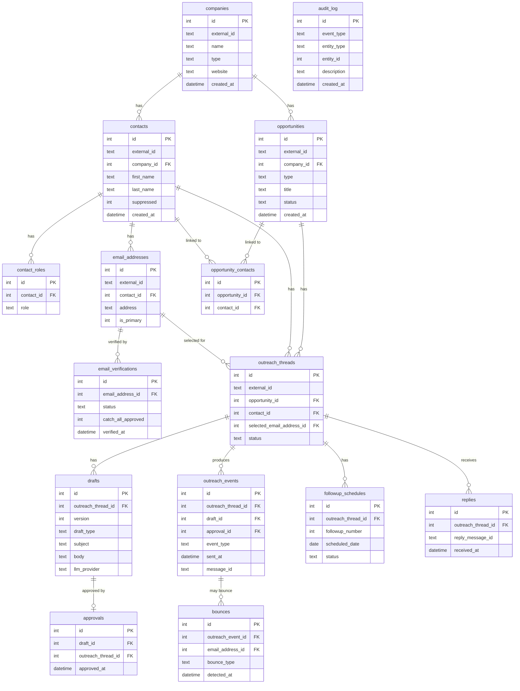

# Database Schema — Tandora Lead Management & Outreach Application

## 1. Overview

All application data is stored in a single SQLite database file (`./data/tandora.db`). The schema is managed by Alembic for incremental, lossless migrations.

The database is the single source of truth. No application state lives exclusively in-memory across restarts.

---

## 2. Entity Summary

| Entity | Table | Purpose |
|--------|-------|---------|
| Company | `companies` | A company (employer or freelance prospect) |
| Opportunity | `opportunities` | A job or freelance engagement at a company |
| Contact | `contacts` | A person at a company |
| Contact Role | `contact_roles` | A role a contact holds (Recruiter, CTO, etc.) |
| Email Address | `email_addresses` | An email address belonging to a contact |
| Verification Result | `email_verifications` | Reoon verification result for an address |
| Outreach Thread | `outreach_threads` | A single outreach engagement (contact + opportunity) |
| Draft | `drafts` | A versioned email draft |
| Approval | `approvals` | An approval record for a draft |
| Outreach Event | `outreach_events` | A sent email or follow-up |
| Follow-up Schedule | `followup_schedules` | Scheduled follow-up for a thread |
| Reply | `replies` | A detected inbound reply |
| Bounce | `bounces` | A detected bounce for a sent message |
| Opportunity Contact | `opportunity_contacts` | Many-to-many: contacts associated with an opportunity |
| Sheets Sync State | `sheets_sync_state` | Last-sync metadata for Google Sheets |
| Audit Log | `audit_log` | Immutable event log |
| App Config | `app_config` | Key-value application configuration |

---

## 3. Table Definitions

### 3.1 `companies`

| Column | Type | Constraints | Description |
|--------|------|-------------|-------------|
| `id` | INTEGER | PK, AUTOINCREMENT | Internal ID |
| `external_id` | TEXT | UNIQUE, NOT NULL | Stable external ID for Sheets sync |
| `name` | TEXT | NOT NULL | Company name |
| `website` | TEXT | | Company website URL |
| `industry` | TEXT | | Industry category |
| `description` | TEXT | | Notes about the company |
| `type` | TEXT | NOT NULL, DEFAULT 'employer' | `employer` or `freelance_prospect` |
| `source_url` | TEXT | | URL where company was first captured |
| `created_at` | DATETIME | NOT NULL, DEFAULT now | Record creation timestamp |
| `updated_at` | DATETIME | NOT NULL, DEFAULT now | Last modification timestamp |
| `sheets_row_id` | TEXT | | Google Sheets row reference |
| `sheets_last_synced_at` | DATETIME | | Last Sheets sync timestamp |

**Indexes**: `idx_companies_name`, `idx_companies_external_id`

---

### 3.2 `opportunities`

| Column | Type | Constraints | Description |
|--------|------|-------------|-------------|
| `id` | INTEGER | PK, AUTOINCREMENT | Internal ID |
| `external_id` | TEXT | UNIQUE, NOT NULL | Stable external ID for Sheets sync |
| `company_id` | INTEGER | FK → companies.id, NOT NULL | Parent company |
| `type` | TEXT | NOT NULL | `employment` or `freelance_prospect` |
| `title` | TEXT | NOT NULL | Job title or engagement description |
| `description` | TEXT | | Full job description or engagement notes |
| `source_url` | TEXT | | URL of job posting or lead page |
| `status` | TEXT | NOT NULL, DEFAULT 'active' | `active`, `paused`, `closed`, `won`, `lost` |
| `created_at` | DATETIME | NOT NULL, DEFAULT now | |
| `updated_at` | DATETIME | NOT NULL, DEFAULT now | |
| `sheets_row_id` | TEXT | | |
| `sheets_last_synced_at` | DATETIME | | |

**Indexes**: `idx_opportunities_company_id`, `idx_opportunities_status`

---

### 3.3 `contacts`

| Column | Type | Constraints | Description |
|--------|------|-------------|-------------|
| `id` | INTEGER | PK, AUTOINCREMENT | Internal ID |
| `external_id` | TEXT | UNIQUE, NOT NULL | Stable external ID for Sheets sync |
| `company_id` | INTEGER | FK → companies.id, NOT NULL | Company this contact belongs to |
| `first_name` | TEXT | NOT NULL | |
| `last_name` | TEXT | | |
| `linkedin_url` | TEXT | | LinkedIn profile URL |
| `notes` | TEXT | | Manual notes |
| `suppressed` | INTEGER | NOT NULL, DEFAULT 0 | 1 = do not contact |
| `suppressed_reason` | TEXT | | Reason for suppression |
| `suppressed_at` | DATETIME | | When suppressed |
| `created_at` | DATETIME | NOT NULL, DEFAULT now | |
| `updated_at` | DATETIME | NOT NULL, DEFAULT now | |
| `sheets_row_id` | TEXT | | |
| `sheets_last_synced_at` | DATETIME | | |

**Indexes**: `idx_contacts_company_id`, `idx_contacts_suppressed`

**Deduplication**: Before inserting a contact, the system checks for an existing contact at the same company with the same `first_name` + `last_name` + `linkedin_url`. If a match exists, the existing record is updated rather than a duplicate created.

---

### 3.4 `contact_roles`

| Column | Type | Constraints | Description |
|--------|------|-------------|-------------|
| `id` | INTEGER | PK, AUTOINCREMENT | |
| `contact_id` | INTEGER | FK → contacts.id, NOT NULL | |
| `role` | TEXT | NOT NULL | e.g., `Recruiter`, `CTO`, `Founder`, `Hiring Manager` |
| `created_at` | DATETIME | NOT NULL, DEFAULT now | |

**Indexes**: `idx_contact_roles_contact_id`
**Unique constraint**: `(contact_id, role)` — prevents duplicate roles per contact.

---

### 3.5 `email_addresses`

| Column | Type | Constraints | Description |
|--------|------|-------------|-------------|
| `id` | INTEGER | PK, AUTOINCREMENT | |
| `external_id` | TEXT | UNIQUE, NOT NULL | Stable ID for Sheets sync |
| `contact_id` | INTEGER | FK → contacts.id, NOT NULL | |
| `address` | TEXT | NOT NULL | The email address |
| `is_primary` | INTEGER | NOT NULL, DEFAULT 0 | 1 = preferred address |
| `source` | TEXT | | Where this address was found |
| `created_at` | DATETIME | NOT NULL, DEFAULT now | |
| `updated_at` | DATETIME | NOT NULL, DEFAULT now | |

**Indexes**: `idx_email_addresses_contact_id`, `idx_email_addresses_address`
**Unique constraint**: `address` — the same email address cannot be associated with two different contacts. If the same address appears for a different contact, a deduplication warning is logged.

---

### 3.6 `email_verifications`

| Column | Type | Constraints | Description |
|--------|------|-------------|-------------|
| `id` | INTEGER | PK, AUTOINCREMENT | |
| `email_address_id` | INTEGER | FK → email_addresses.id, NOT NULL | |
| `status` | TEXT | NOT NULL | `safe`, `catch-all`, `invalid`, `unknown` |
| `catch_all_approved` | INTEGER | NOT NULL, DEFAULT 0 | 1 = user has approved this catch-all address |
| `catch_all_approved_at` | DATETIME | | When catch-all was approved |
| `reoon_response` | TEXT | | Full JSON response from Reoon API |
| `credits_used` | INTEGER | | Credits consumed for this verification |
| `verified_at` | DATETIME | NOT NULL | When verification was performed |
| `expires_at` | DATETIME | | When this result should be re-verified |

**Indexes**: `idx_email_verifications_email_address_id`, `idx_email_verifications_status`

**Note**: Multiple verification records may exist for the same email address over time (re-verification). The most recent record is used for routing decisions.

---

### 3.7 `opportunity_contacts`

Many-to-many association between contacts and opportunities.

| Column | Type | Constraints | Description |
|--------|------|-------------|-------------|
| `id` | INTEGER | PK, AUTOINCREMENT | |
| `opportunity_id` | INTEGER | FK → opportunities.id, NOT NULL | |
| `contact_id` | INTEGER | FK → contacts.id, NOT NULL | |
| `created_at` | DATETIME | NOT NULL, DEFAULT now | |

**Unique constraint**: `(opportunity_id, contact_id)`

---

### 3.8 `outreach_threads`

Represents a single outreach engagement between one contact and one opportunity.

| Column | Type | Constraints | Description |
|--------|------|-------------|-------------|
| `id` | INTEGER | PK, AUTOINCREMENT | |
| `external_id` | TEXT | UNIQUE, NOT NULL | |
| `opportunity_id` | INTEGER | FK → opportunities.id, NOT NULL | |
| `contact_id` | INTEGER | FK → contacts.id, NOT NULL | |
| `selected_email_address_id` | INTEGER | FK → email_addresses.id, NOT NULL | The one address used for this thread |
| `status` | TEXT | NOT NULL, DEFAULT 'draft' | `draft`, `approved`, `sent`, `replied`, `bounced`, `suppressed`, `closed` |
| `created_at` | DATETIME | NOT NULL, DEFAULT now | |
| `updated_at` | DATETIME | NOT NULL, DEFAULT now | |

**Unique constraint**: `(opportunity_id, contact_id)` — one thread per contact per opportunity.

**Indexes**: `idx_outreach_threads_opportunity_id`, `idx_outreach_threads_contact_id`, `idx_outreach_threads_status`

**Note**: The `selected_email_address_id` locks in the recipient for the entire thread. The system will never send to a different address for the same thread, even if other addresses exist for the contact.

---

### 3.9 `drafts`

Versioned email drafts for outreach threads.

| Column | Type | Constraints | Description |
|--------|------|-------------|-------------|
| `id` | INTEGER | PK, AUTOINCREMENT | |
| `outreach_thread_id` | INTEGER | FK → outreach_threads.id, NOT NULL | |
| `version` | INTEGER | NOT NULL | Version number, starting at 1 |
| `draft_type` | TEXT | NOT NULL | `initial` or `followup` |
| `followup_number` | INTEGER | | 1, 2, or 3 for follow-ups |
| `subject` | TEXT | NOT NULL | Email subject line |
| `body` | TEXT | NOT NULL | Email body text |
| `llm_provider` | TEXT | | `gemini` or `ollama` |
| `llm_model` | TEXT | | Model name used for generation |
| `generation_prompt` | TEXT | | Prompt used for generation (for audit) |
| `is_edited` | INTEGER | NOT NULL, DEFAULT 0 | 1 = user manually edited this draft |
| `created_at` | DATETIME | NOT NULL, DEFAULT now | |

**Unique constraint**: `(outreach_thread_id, draft_type, followup_number, version)`

**Indexes**: `idx_drafts_outreach_thread_id`

**Versioning rule**: Each LLM generation or user edit creates a new draft row with an incremented version. The highest version for a given `(outreach_thread_id, draft_type, followup_number)` is the current draft.

---

### 3.10 `approvals`

Records of explicit user approvals for drafts.

| Column | Type | Constraints | Description |
|--------|------|-------------|-------------|
| `id` | INTEGER | PK, AUTOINCREMENT | |
| `draft_id` | INTEGER | FK → drafts.id, NOT NULL, UNIQUE | Only one approval record per draft version |
| `outreach_thread_id` | INTEGER | FK → outreach_threads.id, NOT NULL | |
| `approved_at` | DATETIME | NOT NULL | When approval was recorded |
| `notes` | TEXT | | Optional reviewer notes |

**Rule**: An approval is associated with a specific draft version. If the draft is re-generated or edited, a new draft version is created and the approval is invalidated (the new version must be re-approved).

---

### 3.11 `outreach_events`

Records of sent emails.

| Column | Type | Constraints | Description |
|--------|------|-------------|-------------|
| `id` | INTEGER | PK, AUTOINCREMENT | |
| `outreach_thread_id` | INTEGER | FK → outreach_threads.id, NOT NULL | |
| `draft_id` | INTEGER | FK → drafts.id, NOT NULL | The approved draft that was sent |
| `approval_id` | INTEGER | FK → approvals.id, NOT NULL | The approval record |
| `event_type` | TEXT | NOT NULL | `initial` or `followup` |
| `followup_number` | INTEGER | | 1, 2, or 3 |
| `sent_at` | DATETIME | NOT NULL | When the email was sent |
| `message_id` | TEXT | UNIQUE | SMTP Message-ID header value |
| `recipient_address` | TEXT | NOT NULL | The address it was sent to |
| `smtp_response` | TEXT | | SMTP server response |

**Indexes**: `idx_outreach_events_outreach_thread_id`, `idx_outreach_events_message_id`

---

### 3.12 `followup_schedules`

Planned follow-up events for each outreach thread.

| Column | Type | Constraints | Description |
|--------|------|-------------|-------------|
| `id` | INTEGER | PK, AUTOINCREMENT | |
| `outreach_thread_id` | INTEGER | FK → outreach_threads.id, NOT NULL | |
| `followup_number` | INTEGER | NOT NULL | 1, 2, or 3 |
| `scheduled_date` | DATE | NOT NULL | The calendar date the follow-up is due |
| `status` | TEXT | NOT NULL, DEFAULT 'pending' | `pending`, `approved`, `sent`, `suppressed`, `cancelled` |
| `suppressed_reason` | TEXT | | e.g., `reply_received` |
| `suppressed_at` | DATETIME | | |
| `created_at` | DATETIME | NOT NULL, DEFAULT now | |
| `updated_at` | DATETIME | NOT NULL, DEFAULT now | |

**Unique constraint**: `(outreach_thread_id, followup_number)`

---

### 3.13 `replies`

Inbound replies detected via IMAP.

| Column | Type | Constraints | Description |
|--------|------|-------------|-------------|
| `id` | INTEGER | PK, AUTOINCREMENT | |
| `outreach_thread_id` | INTEGER | FK → outreach_threads.id | Linked thread (null if unmatched) |
| `in_reply_to_message_id` | TEXT | | Message-ID of the email being replied to |
| `reply_message_id` | TEXT | UNIQUE | Message-ID of the reply |
| `sender_address` | TEXT | NOT NULL | Who replied |
| `subject` | TEXT | | Reply subject |
| `received_at` | DATETIME | NOT NULL | When the reply was received |
| `raw_snippet` | TEXT | | First 500 characters of reply body |

---

### 3.14 `bounces`

Bounce notifications detected via IMAP.

| Column | Type | Constraints | Description |
|--------|------|-------------|-------------|
| `id` | INTEGER | PK, AUTOINCREMENT | |
| `outreach_event_id` | INTEGER | FK → outreach_events.id | The send event that bounced |
| `email_address_id` | INTEGER | FK → email_addresses.id | The address that bounced |
| `bounce_type` | TEXT | | `hard` or `soft` |
| `bounce_message` | TEXT | | DSN message content |
| `detected_at` | DATETIME | NOT NULL | |

---

### 3.15 `sheets_sync_state`

| Column | Type | Constraints | Description |
|--------|------|-------------|-------------|
| `id` | INTEGER | PK, AUTOINCREMENT | |
| `entity_type` | TEXT | NOT NULL | `company`, `contact`, `opportunity`, etc. |
| `last_sync_at` | DATETIME | | Last successful sync timestamp |
| `sheets_id` | TEXT | | Google Sheets spreadsheet ID |
| `sheet_name` | TEXT | | Tab name within the spreadsheet |
| `last_sync_checksum` | TEXT | | Hash of last-synced data for change detection |

**Unique constraint**: `(entity_type, sheets_id, sheet_name)`

---

### 3.16 `audit_log`

Immutable event log. No UPDATE or DELETE operations are permitted on this table by the application.

| Column | Type | Constraints | Description |
|--------|------|-------------|-------------|
| `id` | INTEGER | PK, AUTOINCREMENT | |
| `event_type` | TEXT | NOT NULL | e.g., `draft_generated`, `approved`, `email_sent`, `reply_received`, `bounce_detected`, `followup_suppressed`, `sync_completed` |
| `entity_type` | TEXT | | e.g., `outreach_thread`, `contact`, `company` |
| `entity_id` | INTEGER | | ID of the related entity |
| `description` | TEXT | NOT NULL | Human-readable event description |
| `metadata` | TEXT | | JSON payload with additional context |
| `created_at` | DATETIME | NOT NULL, DEFAULT now | |

---

### 3.17 `app_config`

| Column | Type | Constraints | Description |
|--------|------|-------------|-------------|
| `key` | TEXT | PK | Configuration key |
| `value` | TEXT | NOT NULL | Configuration value |
| `description` | TEXT | | Human-readable description |
| `updated_at` | DATETIME | NOT NULL, DEFAULT now | |

**Standard keys**:
- `sending_paused`: `true` or `false`
- `daily_sending_limit`: `20` (integer as string)
- `llm_provider`: `gemini` or `ollama`
- `reoon_credits_used_today`: integer as string
- `imap_poll_interval_minutes`: integer as string

---

## 4. ER Diagram

---

## 5. Data Integrity Rules

### 5.1 Contact Deduplication

Before inserting a new contact, the system must check:
1. Does a contact with the same `first_name` + `last_name` already exist at the same `company_id`?
2. If yes, and `linkedin_url` also matches (or both are null), update the existing record rather than creating a duplicate.
3. If a match exists but `linkedin_url` differs, treat as a distinct person and create a new record.

### 5.2 Email Address Deduplication

The `address` column in `email_addresses` has a UNIQUE constraint. If an attempt is made to associate the same email address with a different contact, the system must:
1. Log a warning to the audit log.
2. Surface the conflict to the user.
3. Not silently reassign the address.

### 5.3 Approval Invalidation

An approval is valid only for the specific `draft_id` it references. If the draft is regenerated or edited:
1. A new draft version is created (new row).
2. The old approval remains in the database (for audit purposes) but is not valid for the new version.
3. The new draft version must be explicitly approved before sending.

### 5.4 Catch-all Gate

The sending pipeline must check the following before dispatching any email:
1. Retrieve the latest `email_verifications` record for `selected_email_address_id`.
2. If `status = 'catch-all'` and `catch_all_approved = 0`, block sending and return an error.
3. If `status = 'invalid'` or `status = 'unknown'`, block sending unconditionally.
4. If `status = 'safe'`, proceed.

### 5.5 Suppression Check

Before generating a draft or sending, check:
1. `contacts.suppressed = 1` → block all activity for this contact.
2. `outreach_threads.status = 'suppressed'` → block sending.
3. Bounced address check: if `selected_email_address_id` has a recorded hard bounce in `bounces`, block sending.

*Note on Canonical Schema*: Suppression is modeled directly on `contacts` (`suppressed`, `suppressed_reason`, `suppressed_at`), `outreach_threads` (`status = 'suppressed'`), and associated bounce/verification records. There is no separate `suppression_list` table.

### 5.6 Outreach Thread Uniqueness

The unique constraint on `(opportunity_id, contact_id)` in `outreach_threads` ensures one thread per person per opportunity. If a thread already exists, the existing thread must be resumed, not duplicated.
