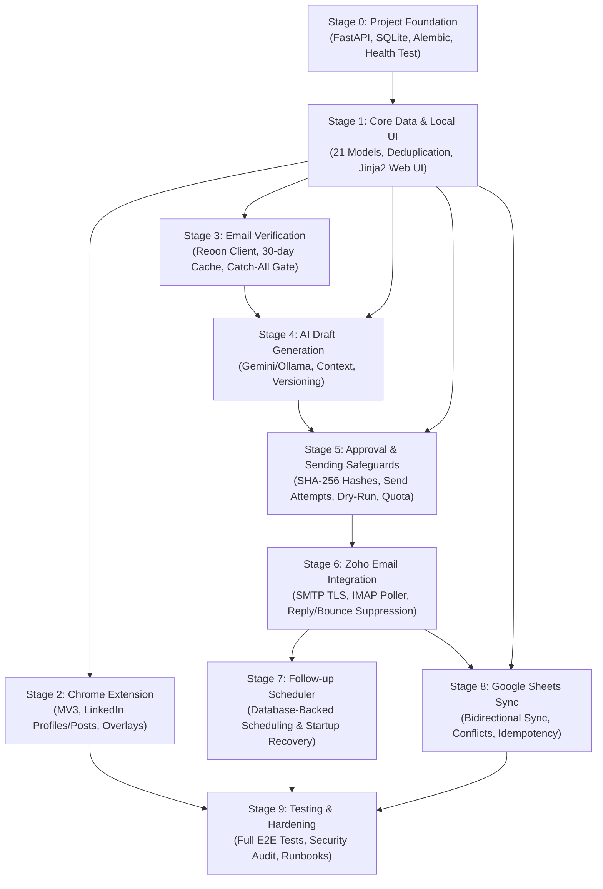

# Implementation Roadmap — Tandora Lead Management & Outreach Application

## Guiding Principles

1. **Usable application early**: Deliver a functional, local management application in Stage 1 so prospects can be created, viewed, edited, and organized immediately.
2. **Approval integrity**: Enforce SHA-256 content hashing before any sending capability is built.
3. **Delivery safety**: Build persistent send-attempt lifecycles with dry-run mode enabled by default before connecting live SMTP.
4. **Resilient scheduling**: Base scheduling entirely on persistent SQLite records with automatic startup recovery.
5. **Strict stage gating**: Complete and test each stage before moving to the next.

---

## Stage 0: Project Foundation

### Objective
Establish the repository structure, Python 3.12 virtual environment, dependency management, SQLite connection with foreign key enforcement, Alembic migration framework, FastAPI application instance, and automated test scaffolding.

### Dependencies
None.

### Features
- Modern `pyproject.toml` configuration with FastAPI, Uvicorn, SQLAlchemy 2.x, Alembic, Pydantic-settings, and Pytest.
- Database session manager with `PRAGMA foreign_keys = ON` and WAL mode enabled.
- Centralized configuration loaded via `pydantic-settings` from gitignored `.env`.
- `.env.example` file documenting all variable names.
- FastAPI app instance binding to `127.0.0.1:8000`.
- Health endpoint (`GET /health`) returning status and timestamp.

### Expected Files / Modules
```
tandora/
├── backend/
│   ├── app/
│   │   ├── __init__.py
│   │   ├── main.py             # FastAPI instance, lifespan handler, router mounting
│   │   ├── config.py           # Settings class with on-demand validation
│   │   └── database.py         # Engine, SessionLocal, PRAGMA listener, Base
│   ├── alembic/
│   │   ├── env.py              # Alembic environment configured with Base.metadata
│   │   └── script.py.mako
│   ├── tests/
│   │   ├── __init__.py
│   │   ├── conftest.py         # Test engine, in-memory DB fixture, test client
│   │   └── test_health.py      # Health endpoint test
│   ├── alembic.ini
│   ├── pyproject.toml
│   └── .env.example
├── .gitignore
├── docs/                       # Complete project documentation
└── skills/                     # Reusable project skills
```

### Tests
- `test_health_returns_200`: `GET /health` returns HTTP 200 with `{"status": "ok"}`.
- `test_foreign_keys_enforced`: Verify SQLite raises `IntegrityError` on orphan foreign key insert.
- `test_unconfigured_integrations_do_not_crash_startup`: Application boots cleanly without live API keys.

### Acceptance Criteria
- `pytest backend/tests/` passes.
- `uvicorn app.main:app --host 127.0.0.1 --port 8000` starts cleanly.
- Alembic runs `alembic upgrade head` without errors.

### Definition of Done
Foundation is running, test suite passes, and the local server responds on `127.0.0.1:8000`.

---

## Stage 1: Core Data Management & Local Interface

### Objective
Implement the 21-table database schema, deterministic contact deduplication, CRUD services, and a functional server-rendered local web management interface (Jinja2 + HTML/CSS).

### Dependencies
Stage 0 complete.

### Features
- Complete SQLAlchemy model definitions for all entities (organizations, opportunities, contacts, contact roles, email addresses, phone numbers, captures, posts, threads, drafts, approvals, send attempts, events, schedules, replies, bounces, sync state, audit log, config).
- Initial Alembic migration creating all tables, indexes, and constraints.
- Contact deduplication service: primary match on normalized LinkedIn URL, secondary on normalized email, cautious flagging for name+company matches (`duplicate_flag = 1`).
- Contact data provenance tracking: individual sources, source URLs, and timestamps for emails and phones.
- Server-rendered local web management interface at `http://127.0.0.1:8000`:
  - **Dashboard**: High-level counts, daily quota usage, pause toggle.
  - **Organizations**: View, create, edit companies and organization-level suppression.
  - **Opportunities**: View and edit job listings / freelance leads.
  - **Contacts**: Contact profiles, title, location, notes, and duplicate flag review.
  - **Emails & Phones**: View channel lists with provenance tags (`ContactOut`, `Apollo`, etc.).
  - **Suppression Management**: Person, address, and organization suppression controls.

### Expected Files / Modules
```
backend/app/
├── models/                     # 21 SQLAlchemy models
│   ├── company.py, opportunity.py, contact.py, contact_role.py
│   ├── email_address.py, phone_number.py, email_verification.py
│   ├── capture.py, linkedin_post.py, opportunity_contact.py
│   ├── outreach_thread.py, draft.py, approval.py, send_attempt.py
│   ├── outreach_event.py, followup_schedule.py, reply.py, bounce.py
│   ├── sheets_sync_state.py, audit_log.py, app_config.py
├── schemas/                    # Pydantic schemas for all entities
├── services/
│   ├── organization_service.py, contact_service.py
│   ├── deduplication_service.py, audit_service.py
├── api/v1/                     # REST API endpoints
└── ui/                         # Server-rendered web interface
    ├── routers/                # UI route handlers (dashboard, contacts, etc.)
    ├── templates/              # Jinja2 HTML templates
    └── static/                 # CSS and lightweight vanilla JS
```

### Tests
- Migration applies cleanly to SQLite.
- Contact deduplication tests: normalized LinkedIn URL matches resolve to same contact; duplicate name without LinkedIn URL flags for review.
- Provenance tests: emails and phone numbers store individual source metadata.
- UI tests: dashboard, organizations, contacts, and suppression views render HTTP 200 with expected HTML content.

### Acceptance Criteria
- User can browse to `http://127.0.0.1:8000` and manually create, view, edit, and organize prospects, companies, opportunities, emails, and phone numbers.
- No duplicate contacts created when same normalized LinkedIn URL is captured.

### Definition of Done
Working local application running in browser; all Stage 1 tests pass.

---

## Stage 2: Chrome Extension (Manifest V3)

### Objective
Build and integrate the Manifest V3 Chrome Extension to capture prospects from LinkedIn profiles, LinkedIn posts, company pages, job listings, and visible ContactOut/Apollo overlays with review popup and manual fallback.

### Dependencies
Stage 1 complete (capture API endpoint available).

### Features
- Manifest V3 extension configuration with `activeTab`, `scripting`, and `storage` permissions. Host permissions restricted to `http://127.0.0.1:8000/*`.
- Background service worker managing extension lifecycle.
- Content script extracting visible DOM elements from:
  - LinkedIn personal profiles (name, headline, company, title, location, profile URL).
  - LinkedIn posts (post author, headline, post text, URL, timestamp, mentioned company; author kept distinct from profile owner).
  - Visible ContactOut and Apollo.io panels when open in the active DOM.
- Manual fallback form in popup: allows pasting text from isolated overlays with heuristic extraction of name, emails, and phones.
- Interactive popup UI: review, edit, select opportunity type, add notes, and submit.
- Keyboard shortcut (`Alt+Shift+T`) to trigger capture.
- Authenticated endpoint `POST /api/v1/captures` validating `X-Extension-Secret`, persisting raw capture in `captures`, and triggering deduplication.

### Expected Files / Modules
```
extension/
├── manifest.json
├── background.js               # Service worker
├── content.js                  # DOM extractor for profiles, posts, overlays
├── popup/
│   ├── popup.html              # Review & edit popup interface
│   ├── popup.js                # Form logic, storage, API submission
│   └── popup.css               # Clean styling
├── parser.js                   # Heuristic text parser for manual paste fallback
└── icons/
backend/app/api/v1/captures.py  # Authenticated capture endpoint
```

### Tests
- Extension loads in Chrome without Manifest V3 warnings.
- `POST /api/v1/captures` with valid `X-Extension-Secret` processes profile capture and creates linked records.
- Missing or invalid secret returns HTTP 401.
- LinkedIn post capture links post author as decision-maker without overwriting opportunity context.

### Acceptance Criteria
- User can press `Alt+Shift+T` on a LinkedIn profile or post, review extracted data in popup, and save it directly into the local database.
- ContactOut and Apollo visible data (or pasted text) saves with correct provenance tags.

### Definition of Done
End-to-end capture verified in Chrome browser; all tests pass.

---

## Stage 3: Email Verification (Reoon)

### Objective
Integrate Reoon Email Verifier API to validate deliverability, enforce 30-day result caching, gate catch-all addresses behind mandatory manual approval, and track credit consumption.

### Dependencies
Stage 1 complete.

### Features
- Reoon API client module with timeout handling and error mapping.
- 30-day caching: check `email_verifications` before calling Reoon.
- Verification classification: `safe`, `catch-all`, `invalid`, `unknown`, `role_account`, `disposable`.
- Catch-all review gate: `catch-all` addresses held in review queue; require explicit manual approval (`catch_all_approved = 1`) via `POST /api/v1/emails/{id}/approve-catchall`.
- Permanent block on `invalid`, `unknown`, and `disposable` addresses.
- Local UI verification badge and catch-all approval toggle.
- Credit tracking: log credits consumed per verification.

### Expected Files / Modules
```
backend/app/
├── integrations/reoon.py       # Reoon API client
├── services/verification_service.py
└── api/v1/email_verification.py
```

### Tests
- Verify `safe` address with mocked Reoon $\rightarrow$ eligible for drafting.
- Verify `catch-all` address $\rightarrow$ held in review queue until approved.
- Verify `invalid` address $\rightarrow$ blocked from outreach.
- Cache test: second verification of same address within 30 days does not call external API.
- Reoon outage test: returns actionable error, does not mark address as verified.

### Acceptance Criteria
- Deliverability accurately classified.
- Catch-all gate enforced: no catch-all address can be used without explicit user action.

### Definition of Done
Verification service and local UI integration passing all mocked tests.

---

## Stage 4: AI Draft Generation

### Objective
Implement LLM-powered draft generation using Gemini API (primary) with local Ollama fallback, entity context assembly, prompt templates, and draft versioning.

### Dependencies
Stage 1 complete (data model) and Stage 3 complete (verification eligibility).

### Features
- Provider abstraction interface (`LLMProvider` protocol) implemented by `GeminiProvider` and `OllamaProvider`.
- Configuration toggle (`llm_provider: 'gemini' | 'ollama'`) switchable without code changes.
- Rich context assembly: organization description, opportunity details, contact background, notes, and LinkedIn post excerpt.
- Prompt template enforcing structured output (`SUBJECT:` and `BODY:`).
- Defensive output validation: check length bounds and absence of unfilled placeholders (`[COMPANY]`, `{{...}}`).
- Versioning engine: each generation inserts a new draft version ($N+1$).
- Thread initialization: `POST /api/v1/outreach-threads` locks selected verified email.

### Expected Files / Modules
```
backend/app/
├── providers/
│   ├── llm_interface.py        # Protocol definition & DraftResult dataclass
│   └── llm_factory.py          # Provider factory
├── integrations/
│   ├── gemini.py               # Google Generative AI client
│   └── ollama.py               # Local Ollama HTTP client
├── services/draft_service.py
└── api/v1/drafts.py
```

### Tests
- Generate draft via mocked Gemini $\rightarrow$ stored as version 1.
- Regenerate draft $\rightarrow$ stored as version 2; version 1 preserved.
- Switch provider to Ollama in config $\rightarrow$ generates draft with same output schema.
- Malformed or placeholder-laden output $\rightarrow$ rejected with generation error.
- Unverified address $\rightarrow$ draft generation blocked.

### Acceptance Criteria
- Personalized drafts generated and versioned.
- Switching providers requires only configuration change.

### Definition of Done
All draft service tests pass with mocked providers; local UI displays draft review.

---

## Stage 5: Approval & Sending Safeguards

### Objective
Implement approval integrity with SHA-256 content hashing, persistent send-attempt lifecycle state machine, delivery serialization lock, 20/day quota, and dry-run mode.

### Dependencies
Stage 4 complete.

### Features
- Approval endpoint (`POST /api/v1/drafts/{id}/approve`):
  - Calculates $\text{SHA256}(\text{recipient} + \text{"\textbackslash n"} + \text{subject} + \text{"\textbackslash n"} + \text{body} + \text{"\textbackslash n"} + \text{draft\_id} + \text{"\textbackslash n"} + \text{version})$.
  - Stores hash and content snapshots in `approvals` table.
- Invalidation on edit: modifying a draft creates version $N+1$, invalidating approval for version $N$.
- 10-point pre-send checklist enforcement against persistent database records.
- Persistent send-attempt lifecycle (`send_attempts`): `pending` $\rightarrow$ `sending` $\rightarrow$ `sent` / `failed` / `unknown`.
- Idempotency key generated and committed before transmission.
- Delivery lock: Python in-process mutex serializing send operations.
- Dry-run mode (`dry_run = true` default): executes full pipeline, validates hash, records lifecycle states, and simulates delivery without SMTP connection.
- Global pause toggle (`POST /api/v1/settings/pause`, `POST /api/v1/settings/resume`).

### Expected Files / Modules
```
backend/app/
├── services/
│   ├── approval_service.py     # Content hash calculation & validation
│   └── send_guard_service.py   # 10 pre-send checks & mutex lock
├── api/v1/
│   ├── approvals.py
│   └── sending.py              # Send attempt initiation
└── models/send_attempt.py
```

### Tests
- Approval generates correct SHA-256 content hash.
- Modifying draft after approval $\rightarrow$ send blocked due to hash mismatch.
- Attempting to send unapproved draft $\rightarrow$ HTTP 403.
- Attempting to send when paused or quota exceeded (20/day) $\rightarrow$ blocked.
- Dry-run dispatch $\rightarrow$ send attempt transitions to `sent` with `dry_run = 1`, no SMTP socket opened.
- Duplicate send attempt with same idempotency key $\rightarrow$ blocked.

### Acceptance Criteria
- Approval integrity mathematically guaranteed by content hash.
- Send-attempt lifecycle persisted in SQLite before any delivery attempt.

### Definition of Done
All Stage 5 safety tests pass; Local UI displays approval and send-attempt status.

---

## Stage 6: Zoho Email Integration (SMTP & IMAP)

### Objective
Connect Zoho SMTP for live outbound transmission and Zoho IMAP for inbound reply and bounce monitoring with automatic follow-up suppression.

### Dependencies
Stage 5 complete.

### Features
- Zoho SMTP client module with TLS 587 encryption, connection timeout, and error handling.
- Message threading: follow-up emails set `In-Reply-To` and `References` headers matching initial sent `Message-ID`.
- Live send transition: when `dry_run = false`, opens SMTP socket, transmits message, and updates `send_attempts` to `sent` or `failed`.
- Indeterminate failure handling: connection drops mid-flight mark attempt as `unknown` (never auto-resend).
- Zoho IMAP poller (background thread or manual trigger):
  - Fetches unread messages and delivery failure reports.
  - Matches replies via `In-Reply-To` / `References` headers.
  - Automatically updates thread to `replied` and cancels pending follow-ups.
  - Detects hard bounces, records bounce in `bounces`, and flags `email_addresses.suppressed = 1`.

### Expected Files / Modules
```
backend/app/
├── integrations/
│   ├── zoho_smtp.py            # SMTP client
│   └── zoho_imap.py            # IMAP poller
└── services/inbox_service.py   # Reply matching & bounce handling
```

### Tests
- Mocked SMTP: successful transmission $\rightarrow$ record `outreach_events`, update `send_attempts.status = 'sent'`.
- Mocked SMTP timeout $\rightarrow$ record `send_attempts.status = 'unknown'`.
- Mocked IMAP reply $\rightarrow$ thread updated to `replied`, all pending follow-ups suppressed.
- Mocked IMAP hard bounce $\rightarrow$ address suppressed, bounce logged.

### Acceptance Criteria
- Live delivery executes with persistent lifecycle state.
- Inbound replies reliably suppress pending follow-ups.

### Definition of Done
SMTP and IMAP integrations pass all mocked unit and integration tests.

---

## Stage 7: Follow-up Scheduler & Recovery

### Objective
Implement persistent, database-backed follow-up scheduling (days 3, 7, and 14) using APScheduler with full recovery across application restarts.

### Dependencies
Stage 6 complete.

### Features
- Upon initial send, insert `followup_schedules` records for days 3, 7, and 14.
- In-process APScheduler engine polling `followup_schedules` periodically.
- Application startup recovery routine:
  1. Queries SQLite for overdue or pending schedules (`scheduled_date <= today`).
  2. Verifies parent thread is not replied, bounced, or suppressed.
  3. Generates follow-up draft if missing (`status = 'draft_ready'`).
  4. Local UI alerts user to review and approve follow-up draft.
  5. Once approved, dispatches via Stage 5 send pipeline.
- Suppression safety: any reply, bounce, or manual suppression automatically cancels future follow-ups.

### Expected Files / Modules
```
backend/app/
├── scheduler/
│   ├── runner.py               # APScheduler lifecycle & job definitions
│   └── recovery.py             # Startup recovery scanner
└── services/followup_service.py
```

### Tests
- Initial send creates 3 persistent follow-up records.
- Simulated restart $\rightarrow$ overdue follow-up is recovered and draft is generated.
- Follow-up cannot send without separate explicit approval and content hash.
- Reply received prior to follow-up date $\rightarrow$ follow-up cancelled.

### Acceptance Criteria
- Follow-up scheduling survives server restarts without duplicate messages.
- Every follow-up requires separate user approval.

### Definition of Done
Scheduler and recovery service tested and verified.

---

## Stage 8: Google Sheets Synchronization

### Objective
Implement manual, bidirectional synchronization with Google Sheets API v4 using service account credentials, stable record IDs, conflict detection, and idempotency.

### Dependencies
Stage 1 complete (data model) and Stage 6 complete (outreach status).

### Features
- Google Sheets API v4 client module.
- Manual sync endpoint (`POST /api/v1/sync/sheets`) and Local UI sync dashboard.
- Stable UUID `external_id` mapping across organizations, opportunities, contacts, and outreach status.
- Conflict detection: flags rows modified in both Sheets and SQLite since last sync.
- Local UI conflict resolver view (`POST /api/v1/sync/resolve-conflict`).
- Idempotency: repeated sync runs without changes produce zero modifications.

### Expected Files / Modules
```
backend/app/
├── integrations/google_sheets.py
├── services/sync_service.py
└── api/v1/sync.py
```

### Tests
- Sync empty spreadsheet $\rightarrow$ exports all local records with headers.
- Update row in Sheets $\rightarrow$ sync updates local SQLite record.
- Update in both sources $\rightarrow$ conflict flagged, not auto-overwritten.
- Double sync with no changes $\rightarrow$ idempotent zero operations.

### Acceptance Criteria
- Bidirectional sync operates reliably without data loss or silent overwrites.

### Definition of Done
Google Sheets sync service verified with mocked API tests.

---

## Stage 9: Integration Testing & Hardening

### Objective
Execute comprehensive end-to-end integration tests, verify security boundaries, test failure recovery, polish user-facing error messages, and document final operational instructions.

### Dependencies
All prior stages complete.

### Features
- End-to-end workflow test 1: Employment opportunity $\rightarrow$ LinkedIn capture $\rightarrow$ Reoon verification $\rightarrow$ Gemini draft $\rightarrow$ approval hash $\rightarrow$ dry-run send $\rightarrow$ IMAP reply detected $\rightarrow$ follow-up auto-suppressed.
- End-to-end workflow test 2: Freelance prospect $\rightarrow$ post capture $\rightarrow$ draft $\rightarrow$ send $\rightarrow$ follow-up schedule $\rightarrow$ startup recovery $\rightarrow$ follow-up approved and sent.
- Security boundary test: verify localhost binding (`127.0.0.1`), extension secret enforcement, and credential leakage prevention in logs.
- Operational documentation in README with Windows 11 setup and startup instructions.

### Tests
- Full test suite execution: `pytest backend/tests/ -v` passes with $> 80\%$ overall coverage and $100\%$ coverage on pre-send checks and approval hash verification.
- Zero regressions across previous stage tests.

### Acceptance Criteria
- Complete application is operational, hardened, and verified for single-user Windows 11 daily use.

### Definition of Done
All tests pass, documentation is verified, and project is implementation-ready.

---

## Implementation Stage Dependency Graph


