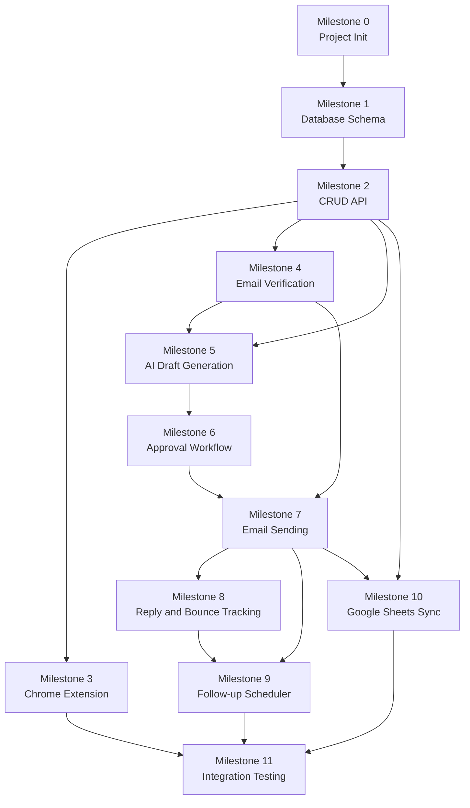

# Implementation Roadmap — Tandora Lead Management & Outreach Application

## Guiding Principles

1. **Usability first**: Each milestone must produce a working, testable increment of the application. The system becomes useful as early as possible.
2. **No unapproved sends**: The approval gate must be in place before any email sending capability is built.
3. **Incremental integration**: External services are integrated one at a time and tested in isolation.
4. **Schema stability**: The database schema is defined once (Milestone 1) and evolved through Alembic migrations only.
5. **Stop and review**: Each milestone ends with a review checkpoint. No milestone is started until the previous one passes its acceptance criteria.

---

## Milestone 0: Project Initialization

### Objective
Establish the project structure, development environment, and tooling. No application logic yet.

### Dependencies
None.

### Features
- Python 3.12 virtual environment.
- Project directory structure.
- `pyproject.toml` with all dependencies listed.
- FastAPI installed and running (returns `{"status": "ok"}` on `GET /health`).
- Alembic configured and connected to SQLite.
- `.env.example` file with all required variable names.
- `.gitignore` configured.
- `pytest` configured and running (zero tests, but test infrastructure works).

### Expected Files / Modules
```
tandora/
├── backend/
│   ├── app/
│   │   ├── __init__.py
│   │   ├── main.py          # FastAPI app instance
│   │   ├── config.py        # Settings loaded from env
│   │   └── database.py      # SQLAlchemy engine + session
│   ├── alembic/
│   │   ├── env.py
│   │   └── versions/        # Empty initially
│   ├── tests/
│   │   └── test_health.py
│   ├── alembic.ini
│   ├── pyproject.toml
│   └── .env.example
├── extension/               # Empty directory
└── docs/                    # Documentation (already complete)
```

### Tests
- `GET /health` returns HTTP 200.
- Database file is created on startup.
- Unconfigured integrations produce clear, actionable errors upon invocation without preventing application startup.

### Acceptance Criteria
- Server starts with `uvicorn app.main:app`.
- Health endpoint responds.
- Alembic can run `alembic upgrade head` without error.
- All env vars are documented in `.env.example`.

### Definition of Done
- Server starts.
- Health endpoint passes.
- Empty migration history created.
- README with setup instructions exists.

---

## Milestone 1: Core Database Schema

### Objective
Implement the complete database schema via Alembic. No API endpoints yet.

### Dependencies
Milestone 0 complete.

### Features
- All SQLAlchemy model definitions (see DATABASE_SCHEMA.md).
- Initial Alembic migration creating all tables.
- All constraints, indexes, and foreign keys defined.

### Expected Files / Modules
```
backend/
└── app/
    └── models/
        ├── __init__.py
        ├── company.py
        ├── opportunity.py
        ├── contact.py
        ├── contact_role.py
        ├── email_address.py
        ├── email_verification.py
        ├── opportunity_contact.py
        ├── outreach_thread.py
        ├── draft.py
        ├── approval.py
        ├── outreach_event.py
        ├── followup_schedule.py
        ├── reply.py
        ├── bounce.py
        ├── sheets_sync_state.py
        ├── audit_log.py
        └── app_config.py
```

### Tests
- Alembic migration runs without errors.
- All tables exist in the database after migration.
- Foreign key constraints are enforced (SQLite must have `PRAGMA foreign_keys = ON`).
- Unique constraints are enforced (attempt to insert duplicate; expect IntegrityError).

### Acceptance Criteria
- `alembic upgrade head` creates all tables.
- All foreign key relationships are correct.
- Unique constraints are tested.

### Definition of Done
- Schema matches DATABASE_SCHEMA.md exactly.
- All model tests pass.

---

## Milestone 2: Company, Opportunity, and Contact API

### Objective
Implement the core CRUD API for companies, opportunities, and contacts. This enables data capture.

### Dependencies
Milestone 1 complete.

### Features
- API endpoints for companies (create, read, list, update).
- API endpoints for opportunities (create, read, list, update, link to company).
- API endpoints for contacts (create, read, list, update, deduplication logic).
- API endpoints for contact roles (add, list).
- API endpoints for email addresses (add, list, deduplication check).
- Pydantic request/response schemas for all endpoints.
- Contact deduplication logic.
- Email address uniqueness enforcement.

### Expected Files / Modules
```
backend/app/
├── api/
│   ├── __init__.py
│   ├── v1/
│   │   ├── __init__.py
│   │   ├── companies.py
│   │   ├── opportunities.py
│   │   └── contacts.py
├── schemas/
│   ├── __init__.py
│   ├── company.py
│   ├── opportunity.py
│   └── contact.py
└── services/
    ├── __init__.py
    ├── company_service.py
    ├── opportunity_service.py
    └── contact_service.py
```

### Tests
- Create a company, retrieve it, list all companies.
- Create an opportunity under a company.
- Create a contact with deduplication: second identical contact returns existing.
- Add multiple roles to a contact; duplicate role rejected.
- Add multiple email addresses; duplicate address returns conflict error.
- All endpoints return correct HTTP status codes.

### Acceptance Criteria
- Full CRUD available for companies, opportunities, contacts.
- Deduplication works as specified.
- All Pydantic schemas validate correctly.

### Definition of Done
- All Milestone 2 tests pass.
- No hardcoded data in any endpoint.

---

## Milestone 3: Chrome Extension — Data Capture

### Objective
Build the Chrome Extension so the user can capture companies and opportunities from browser pages.

### Dependencies
Milestone 2 complete (the extension needs the API to exist).

### Features
- Manifest V3 extension structure.
- Background service worker.
- Popup UI: displays captured URL, title, editable fields.
- Content script to extract page metadata.
- Keyboard shortcut to open the popup.
- POST to `/api/v1/captures` with extension secret header.
- Backend `/api/v1/captures` endpoint that processes captured data.
- Backend validates the extension secret.

### Expected Files / Modules
```
extension/
├── manifest.json
├── background.js
├── popup/
│   ├── popup.html
│   ├── popup.js
│   └── popup.css
├── content.js
└── icons/
    └── icon.png
backend/app/api/v1/
└── captures.py
```

### Tests
- Extension loads in Chrome without manifest errors.
- Popup opens and displays current page URL and title.
- POST to `/api/v1/captures` with valid secret creates a Company and Opportunity.
- POST with invalid/missing secret returns HTTP 401.
- Duplicate company name reuses existing company record.

### Acceptance Criteria
- Extension installed as unpacked in Chrome.
- Keyboard shortcut opens the popup.
- Submission creates records in the database.
- Secret validation works.

### Definition of Done
- Capture workflow works end-to-end from browser to database.

---

## Milestone 4: Email Verification

### Objective
Integrate Reoon to verify contact email addresses before outreach.

### Dependencies
Milestone 2 complete.

### Features
- `POST /api/v1/emails/{email_address_id}/verify` endpoint.
- Reoon API client module.
- Verification result storage in `email_verifications`.
- Result caching (avoid re-verifying recently verified addresses).
- `catch-all` approval endpoint: `POST /api/v1/emails/{email_address_id}/approve-catchall`.
- Credit tracking.
- Audit log entries for all verification events.

### Expected Files / Modules
```
backend/app/
├── integrations/
│   ├── __init__.py
│   └── reoon.py
├── api/v1/
│   └── email_verification.py
└── services/
    └── verification_service.py
```

### Tests
- Mocked Reoon API: verify a `safe` address → stored correctly.
- Mocked Reoon API: verify a `catch-all` address → flagged, not usable until approved.
- Mocked Reoon API: verify an `invalid` address → stored, blocked from outreach.
- Approve a catch-all address → `catch_all_approved = 1`.
- Cache hit: second verification of same address does not call Reoon again.
- Credits updated after each call.
- Audit log entries created for each event.

### Acceptance Criteria
- All verification statuses handled correctly.
- Catch-all gate works.
- Credits tracked.

### Definition of Done
- All Milestone 4 tests pass using mocked Reoon.
- Ready for live Reoon key once available.

---

## Milestone 5: AI Draft Generation

### Objective
Implement LLM-powered email draft generation with provider abstraction.

### Dependencies
Milestone 2 complete (needs company/contact data). Milestone 4 complete (must check address usability before generating).

### Features
- Outreach thread creation: `POST /api/v1/outreach-threads`.
- Draft generation: `POST /api/v1/outreach-threads/{thread_id}/drafts/generate`.
- Gemini API client module.
- Ollama API client module.
- LLM provider abstraction (interface/protocol pattern).
- Draft versioning logic.
- Prompt template stored in configuration.
- Audit log entries for draft generation.

### Expected Files / Modules
```
backend/app/
├── integrations/
│   ├── gemini.py
│   └── ollama.py
├── providers/
│   ├── __init__.py
│   ├── llm_interface.py
│   └── llm_factory.py
├── api/v1/
│   ├── outreach_threads.py
│   └── drafts.py
└── services/
    ├── outreach_service.py
    └── draft_service.py
```

### Tests
- Create an outreach thread for a contact + opportunity pair.
- Duplicate thread creation returns existing thread ID.
- Generate a draft using mocked Gemini → draft stored with version 1.
- Generate again → draft stored with version 2.
- Switch provider to Ollama (mocked) → same interface, same result structure.
- Generation fails → no draft record created.
- Selected address not verified → generation returns error.
- Audit log entry created for each generation.

### Acceptance Criteria
- Both providers work via the same interface.
- Draft versioning is correct.
- Address usability is checked before generation.

### Definition of Done
- All Milestone 5 tests pass with mocked LLMs.
- Ready for live API keys.

---

## Milestone 6: Approval Workflow

### Objective
Implement the approval gate. No email can be sent without a recorded approval.

### Dependencies
Milestone 5 complete.

### Features
- Draft retrieval: `GET /api/v1/outreach-threads/{thread_id}/drafts/current`.
- Draft editing: `PUT /api/v1/drafts/{draft_id}` (creates new version with `is_edited = 1`).
- Draft approval: `POST /api/v1/drafts/{draft_id}/approve`.
- Validation: only the current version can be approved.
- Audit log entries for approval events.

### Tests
- Approve a draft → approval record created.
- Approve an older version → rejected.
- Edit a draft → new version created, old approval no longer valid for new version.
- Approve the edited version → succeeds.

### Acceptance Criteria
- Approval records are correctly linked to specific draft versions.
- Edited drafts require re-approval.

### Definition of Done
- Approval gate is enforced. Tests pass.

---

## Milestone 7: Email Sending

### Objective
Send approved emails via Zoho SMTP with all safety controls.

### Dependencies
Milestone 6 complete (approval required). Milestone 4 complete (address verification required).

### Features
- Send endpoint: `POST /api/v1/outreach-threads/{thread_id}/send`.
- Zoho SMTP client module.
- Pre-send checklist enforcement (all 10 mandatory checks from SECURITY_AND_COMPLIANCE.md § 9.1).
- Daily quota management.
- Global pause toggle: `POST /api/v1/settings/pause`, `POST /api/v1/settings/resume`.
- Follow-up schedule creation after successful send (days 3, 7, 14).
- `outreach_events` record creation.
- Audit log entries.

### Expected Files / Modules
```
backend/app/
├── integrations/
│   └── zoho_smtp.py
├── api/v1/
│   └── sending.py
└── services/
    └── sending_service.py
```

### Tests
- Send approved email → `outreach_events` record created, follow-up schedules created.
- Send without approval → HTTP 403, `send_blocked` audit entry.
- Send when globally paused → blocked.
- Send when daily limit reached → blocked.
- Send to suppressed contact → blocked.
- Send to unverified address → blocked.
- Send to `catch-all` without approval → blocked.
- Duplicate send prevention (same thread, same type) → blocked.
- SMTP failure → no `outreach_events` record, quota not incremented.

### Acceptance Criteria
- All pre-send checks enforced.
- Quota tracked correctly across process restarts.
- Audit log captures every blocked or successful send.

### Definition of Done
- All Milestone 7 tests pass with mocked Zoho SMTP.
- Ready for live SMTP credentials.

---

## Milestone 8: Reply and Bounce Tracking

### Objective
Monitor the Zoho inbox for replies and bounce notifications.

### Dependencies
Milestone 7 complete (need sent message IDs to match against).

### Features
- Zoho IMAP client module.
- IMAP polling job (run via scheduler or manual trigger for testing).
- Reply detection and thread matching.
- Bounce detection and address flagging.
- Follow-up suppression on reply detection.
- Audit log entries for all events.

### Expected Files / Modules
```
backend/app/
├── integrations/
│   └── zoho_imap.py
└── services/
    └── inbox_service.py
```

### Tests
- Mocked IMAP: message with matching `In-Reply-To` → reply recorded, follow-ups suppressed.
- Mocked IMAP: DSN bounce message → bounce recorded, address flagged.
- Mocked IMAP: unmatched message → no association, no error.
- Follow-up suppression: all pending follow-ups for the thread are suppressed.
- Audit log entries created.

### Acceptance Criteria
- Reply correctly linked to outreach thread.
- Bounce correctly linked to address.
- Follow-ups suppressed on reply.

### Definition of Done
- All Milestone 8 tests pass with mocked IMAP.

---

## Milestone 9: Follow-up Scheduler

### Objective
Run the persistent scheduler to automatically generate and send follow-ups on schedule.

### Dependencies
Milestone 7 complete. Milestone 8 complete (suppress on reply).

### Features
- APScheduler integration (or equivalent).
- Scheduler starts with the FastAPI application.
- Job: check for due follow-ups, generate drafts, update status to `draft_ready`.
- Job: check for approved follow-ups, send if all pre-send checks pass.
- Job: poll IMAP inbox (every N minutes, configurable).
- Scheduler respects global pause and daily quota.
- Audit log entries for all scheduler actions.

### Tests
- Scheduler runs on startup.
- Due follow-up draft is generated automatically.
- Approved follow-up is sent on next scheduler run.
- Scheduler respects global pause.
- Scheduler respects daily quota.
- Reply received before follow-up is sent → follow-up suppressed before dispatch.

### Acceptance Criteria
- Full follow-up lifecycle works without manual API calls for generation and sending.
- Approval step remains manual.

### Definition of Done
- Scheduler runs correctly. All tests pass.

---

## Milestone 10: Google Sheets Sync

### Objective
Implement manual bidirectional synchronization with Google Sheets.

### Dependencies
Milestone 2 complete (entities to sync). Milestone 7 complete (outreach status to export).

### Features
- Google Sheets API client module.
- Sync endpoint: `POST /api/v1/sync/sheets`.
- Conflict detection.
- Conflict resolution endpoint: `POST /api/v1/sync/resolve-conflict`.
- `sheets_sync_state` management.
- Idempotency enforcement.
- Audit log entries.

### Tests
- Sync with no changes → zero creates, zero updates, zero conflicts.
- New record in Sheets → imported to SQLite.
- New record in SQLite → exported to Sheets.
- Record changed in Sheets only → SQLite updated.
- Record changed in SQLite only → Sheets updated.
- Record changed in both → conflict surfaced, not auto-resolved.
- Running sync twice → idempotent result.

### Acceptance Criteria
- All sync scenarios handled correctly.
- Conflicts surfaced, never silently overwritten.
- Idempotency verified.

### Definition of Done
- All Milestone 10 tests pass with mocked Sheets API.
- Ready for live Google credentials.

---

## Milestone 11: Integration Testing and Polish

### Objective
End-to-end testing of the complete workflow. Bug fixes, error message improvements, and documentation updates.

### Dependencies
All previous milestones complete.

### Features
- End-to-end test: capture → verify → draft → approve → send → reply detected → follow-ups suppressed.
- End-to-end test: capture → draft → send → no reply → follow-up generated → follow-up approved → follow-up sent.
- Error message review: all user-facing errors are clear and actionable.
- README updated with complete setup instructions.
- `.env.example` reviewed for completeness.

### Tests
- Full workflow tests covering both primary scenarios.
- Regression: all previous milestone tests still pass.

### Acceptance Criteria
- Both primary workflows complete without errors.
- All previous tests pass.
- Setup instructions are accurate.

### Definition of Done
- Application is ready for daily use.
- No known blocking bugs.

---

## Dependency Graph


