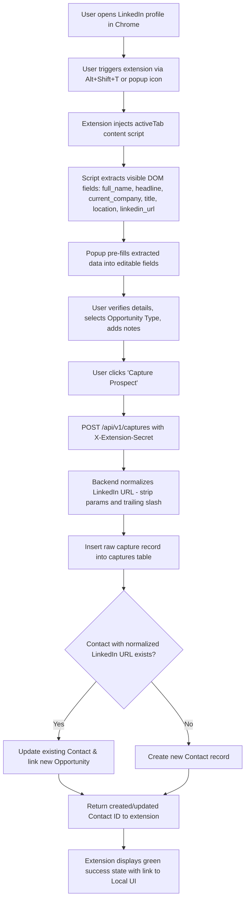
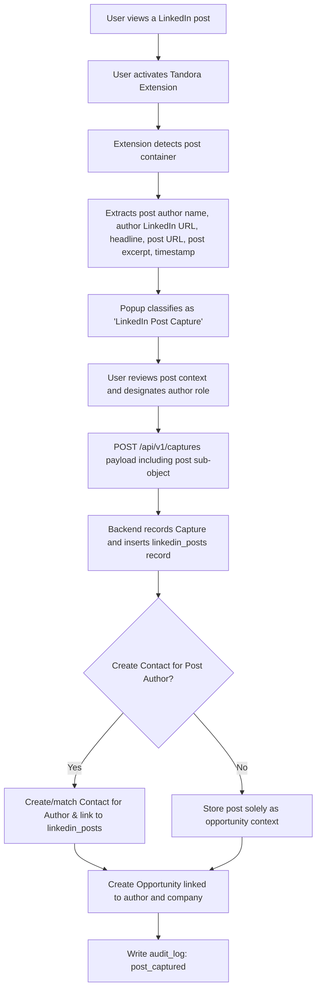
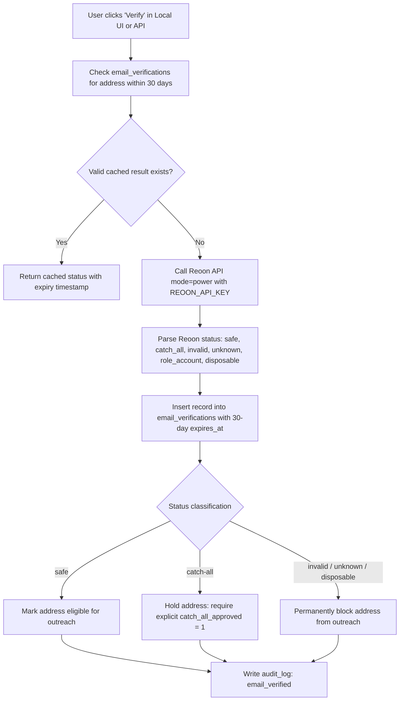
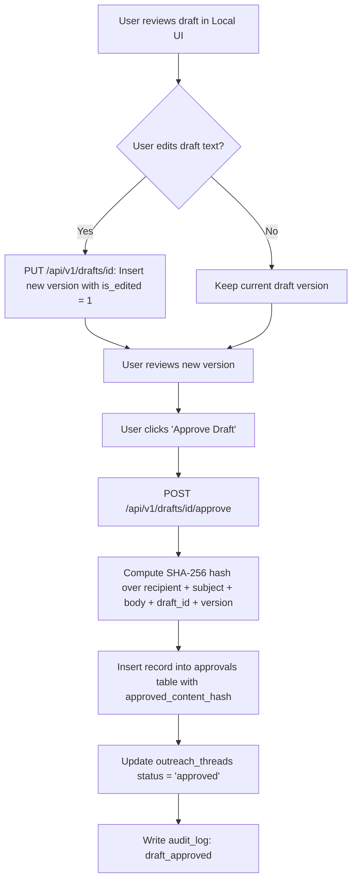

# Workflows — Tandora Lead Management & Outreach Application

## Overview

This document specifies the complete user and system workflows for Tandora. Each workflow defines the exact interaction sequence across the Chrome Extension, Local Web UI, FastAPI backend, SQLite database, and external integrations.

---

## Workflow 1: Capture a LinkedIn Individual Profile

**Purpose**: Extract structured prospect and organization data while browsing an individual's LinkedIn profile.



**Steps**:
1. User navigates to a LinkedIn profile (e.g. `https://www.linkedin.com/in/janedoe/`).
2. User triggers the Tandora extension popup via keyboard shortcut (`Alt+Shift+T`) or toolbar icon.
3. Content script reads visible profile elements:
   - Full Name, First Name, Last Name.
   - Headline / Current Job Title.
   - Current Company / Organization Name.
   - Company Website (if linked).
   - Location.
   - LinkedIn Profile URL.
4. Popup pre-populates extracted fields in an editable review form.
5. User selects opportunity intent: `employment` (e.g. hiring manager/recruiter) or `freelance_prospect` (e.g. potential client).
6. User clicks **"Capture Prospect"**.
7. Extension submits JSON payload to `POST /api/v1/captures` with `X-Extension-Secret`.
8. Backend canonicalizes the LinkedIn URL and evaluates deduplication rules.
9. Database commits records in `captures`, `companies`, `contacts`, and `opportunities`.
10. Extension displays success confirmation.

---

## Workflow 2: Capture a LinkedIn Post (Author & Context)

**Purpose**: Capture a hiring announcement or business opportunity post from LinkedIn, preserving the author as a decision-maker without conflating the post with a personal profile.



**Steps**:
1. User views a post on LinkedIn (e.g. a CTO posting *"We're hiring a Senior DevOps Engineer"*).
2. User activates the Tandora extension.
3. Content script identifies post container and extracts:
   - Post author full name.
   - Author LinkedIn URL.
   - Author headline.
   - Post canonical URL and timestamp.
   - Post text body / excerpt.
   - Mentioned organizations.
4. Popup displays extracted post context and pre-fills an Opportunity title (e.g., *"Hiring DevOps Engineer"*).
5. User confirms whether the author should be registered as a decision-maker contact.
6. Extension submits payload to `POST /api/v1/captures`.
7. Backend inserts a `captures` record and a child `linkedin_posts` record, linking the author to `contacts` and creating the associated `opportunities` record.

---

## Workflow 3: Capture Third-Party Overlays (ContactOut & Apollo) with Essential Manual Fallback

**Purpose**: Capture contact information displayed by the user's installed third-party extensions when available, with a mandatory manual paste fallback.

**Compliance & Boundary Rules**:
- *No undocumented API calls, no token scraping, no server-side crawling.*
- *Read visibly rendered DOM elements in the active browser tab only when accessible.*
- *DOM extraction is strictly conditional and best-effort: closed shadow roots, isolated extension contexts, and sandboxed iframes prevent content script traversal. The manual paste fallback is essential and mandatory.*

```mermaid
flowchart TD
    A[User opens LinkedIn profile or company site] --> B[User manually opens ContactOut or Apollo panel]
    B --> C[Provider renders visible email/phone information]
    C --> D[User opens Tandora Extension]
    D --> E{Are overlay elements accessible in active DOM?}
    E -->|Yes (Conditional)| F[Content script extracts visible emails, phones, names]
    E -->|No / Closed Shadow DOM| G[Essential Manual Fallback: User copies text from overlay into Tandora form]
    F --> H[Tandora parser detects provider source: ContactOut or Apollo]
    G --> H
    H --> I[Popup displays extracted emails and phones with individual provenance tags]
    I --> J[User verifies details and clicks Save]
    J --> K[POST /api/v1/captures with emails and phone numbers arrays]
    K --> L[Backend inserts distinct email_addresses and phone_numbers with source metadata]
```

**Steps**:
1. User browses to a prospect profile and manually opens the ContactOut or Apollo.io overlay.
2. The third-party extension displays work emails, personal emails, or direct phone numbers.
3. User opens the Tandora extension.
4. Tandora content script attempts to inspect visible overlay containers in the active tab (conditional/best-effort).
5. If accessible: Tandora extracts contact strings and tags the source as `ContactOut` or `Apollo`.
6. **Essential Manual Fallback (Mandatory Core Feature)**: When the provider panel is rendered inside a closed shadow root (`shadowRoot` mode `closed`), sandboxed iframe, or isolated extension context:
   - User highlights and copies the visible contact text from the third-party panel.
   - User pastes the text into Tandora's popup **"Quick Import / Paste"** box.
   - Client-side heuristic parser extracts email patterns, phone patterns, and names into structured fields.
7. User reviews the structured emails and phone numbers.
8. Extension submits to `POST /api/v1/captures`.
9. Backend saves each email address in `email_addresses` and each phone number in `phone_numbers` as an independent record with `source = 'ContactOut'` or `source = 'Apollo'`, `source_url`, and `captured_at`.

---

## Workflow 4: Manage Records via Local Web UI

**Purpose**: Manage organizations, opportunities, contacts, and deliverability from the local server-rendered web application.

**Steps**:
1. User navigates to `http://127.0.0.1:8000/` in Chrome.
2. **Dashboard**: User checks key counts (total prospects, pending drafts, unapproved catch-alls, sent today out of 20).
3. **Organizations**: User views organization list, adds descriptions, edits websites, or flags organization-level suppression.
4. **Contacts**: User views contacts, inspects normalized LinkedIn URLs, reviews duplicate warning flags (`duplicate_flag = 1`), and merges or approves distinct identities.
5. **Emails & Phones**: User inspects contact channels, viewing provenance tags (`ContactOut`, `Apollo`, etc.) and verified deliverability badges.
6. **Global Controls**: User can toggle the global pause switch with one click.

---

## Workflow 5: Email Verification via Reoon

**Purpose**: Verify deliverability and enforce catch-all review before draft generation.



**Steps**:
1. User triggers verification for an email address in the Local UI or via API `POST /api/v1/emails/{id}/verify`.
2. Backend checks `email_verifications` for a cached result from the last 30 days. If found, returns cache immediately.
3. If uncached, backend calls the Reoon API (`https://emailverifier.reoon.com/api/v1/verify?email=...&key=...&mode=power`).
4. Reoon returns deliverability classification and credits used.
5. Backend stores result in `email_verifications`.
6. Routing:
   - `safe`: marked ready for AI drafting.
   - `catch-all`: held in review queue; local UI prompts user to click **"Approve Catch-All"** (`POST /api/v1/emails/{id}/approve-catchall`) before it can be used.
   - `invalid`, `unknown`, `disposable`: blocked unconditionally.
7. Event recorded in `audit_log`.

---

## Workflow 6: Generate AI Outreach Drafts

**Purpose**: Generate personalized email drafts with full version history using Gemini or local Ollama.

**Steps**:
1. User navigates to Outreach Thread in Local UI and clicks **"Generate AI Draft"**.
2. Backend verifies that the thread's `selected_email_address_id` is verified (`safe` or approved `catch-all`).
3. Backend checks that contact and organization are not suppressed.
4. Backend retrieves context:
   - Organization name, description, website.
   - Opportunity title, description, and requirements.
   - Contact name, roles, headline, notes.
   - Associated LinkedIn post text (if captured from a post).
5. Backend formats prompt template and calls configured provider (Gemini or Ollama).
6. Backend parses structured output into subject and body, validating absence of placeholders (`[COMPANY]`, `{{...}}`).
7. Backend inserts a new row in `drafts` with an incremented version number (`version = N+1`).
8. Local UI displays the newly generated draft alongside version history and diffs.

---

## Workflow 7: Review, Edit & Approve Draft with SHA-256 Content Hash

**Purpose**: Guarantee that an email can only be sent if its content is bit-for-bit identical to what the user explicitly approved.



**Steps**:
1. User reviews the draft in the Local UI.
2. If user modifies subject or body:
   - Backend creates a new row in `drafts` with `is_edited = 1` and `version = N+1`.
   - Any prior approval on version $N$ is invalid for version $N+1$.
3. When satisfied, user clicks **"Approve Draft"**.
4. Backend calculates SHA-256 hash:
   $$\text{approved\_content\_hash} = \text{SHA256}(\text{recipient} + \text{"\textbackslash n"} + \text{subject} + \text{"\textbackslash n"} + \text{body} + \text{"\textbackslash n"} + \text{draft\_id} + \text{"\textbackslash n"} + \text{version})$$
5. Backend inserts approval record in `approvals` table storing the hash and content snapshots.
6. Thread status transitions to `approved`.

---

## Workflow 8: Send Approved Email via Persistent Send Attempt Lifecycle

**Purpose**: Deliver email safely with zero risk of duplicate delivery, enforcing all 10 pre-send checks and persistent state machine tracking.

**10 Mandatory Pre-Send Checks**:
1. Valid approval exists for the exact current draft version.
2. Global pause toggle is disabled (`sending_paused == 'false'`).
3. Global daily sending quota has not been exceeded ($< 20$ sent today).
4. Contact is not suppressed (`contacts.suppressed == 0`).
5. Selected email address is not suppressed (no hard bounce in `bounces`).
6. Email address meets verification eligibility (`safe` or approved `catch-all`).
7. Catch-all address has separate explicit approval (`catch_all_approved == 1`).
8. Recipient has not already received an outbound email for this thread and event type.
9. Outreach thread is eligible for sending (not `suppressed`, `replied`, `bounced`, or `closed`).
10. Current draft content SHA-256 hash matches `approvals.approved_content_hash`.

**Steps**:
1. Dispatch triggered manually in UI or via Scheduler.
2. In-process delivery serialization lock acquired (auxiliary process safeguard).
3. SQLite transaction initiated (`BEGIN IMMEDIATE`) for authoritative quota verification, unique idempotency key validation, and attempt creation.
4. Pre-send engine executes all 10 checks against persistent database records.
5. If any check fails: send is aborted, `send_blocked` recorded in `audit_log`, transaction rolled back, in-process lock released.
6. Unique deterministic `idempotency_key` generated (`SHA256(thread_id + "_" + draft_id + "_" + approval_id + "_" + attempt_number)`).
7. Backend inserts `send_attempts` record with `status = 'pending'` and **COMMITS** the database transaction.
8. Backend transitions `send_attempts.status = 'sending'`.
9. **Mode Execution**:
   - *If `dry_run = true`*: Simulated delivery; update `send_attempts.status = 'sent'`, `dry_run = 1`.
   - *If `dry_run = false`*: Open TLS 587 socket to Zoho SMTP; transmit message.
10. **Outcome Handling**:
    - *SMTP 250 OK*: Update `send_attempts.status = 'sent'`, record `message_id`. Insert `outreach_events` record. Schedule follow-ups for days 3, 7, 14. Increment daily counter.
    - *SMTP 5xx Permanent Failure*: Update `send_attempts.status = 'failed'`, record error message.
    - *Connection Timeout / Mid-flight Disconnect*: Update `send_attempts.status = 'unknown'`. Flag for manual user reconciliation. **NEVER auto-resend an unknown attempt.**
11. Release in-process delivery lock.

---

## Workflow 9: Monitor Replies, Bounces & Auto-Suppress

**Purpose**: Continuously inspect Zoho inbox via IMAP to correlate replies, auto-suppress follow-ups, and flag hard bounces.

**Steps** (Runs every 15 minutes via APScheduler or manual UI trigger):
1. Poller connects to Zoho IMAP over SSL (port 993).
2. Fetches unread messages in `INBOX` and delivery status failure folders.
3. For each message:
   - **Reply Matching**: Inspects `In-Reply-To` and `References` headers. If matching a sent `outreach_events.message_id`:
     - Inserts record into `replies`.
     - Updates `outreach_threads.status = 'replied'`.
     - Updates all pending `followup_schedules` for this thread to `status = 'suppressed'`, `suppressed_reason = 'reply_received'`.
     - Writes `reply_received` and `followup_suppressed` entries to `audit_log`.
   - **Bounce Detection**: If message is a DSN / bounce report:
     - Extracts bounced email address.
     - Inserts record into `bounces` table (`bounce_type = 'hard'`).
     - Updates `email_addresses.suppressed = 1`, `suppressed_reason = 'hard_bounce'`.
     - Cancels all pending follow-ups for that address.
4. Marks processed IMAP messages as seen.

---

## Workflow 10: Follow-up Scheduling & Startup Recovery

**Purpose**: Execute scheduled follow-ups reliably across laptop reboots without duplicate dispatches.

**Steps**:
1. When initial email is sent, records are inserted into `followup_schedules` with:
   - Follow-up 1: `scheduled_date = today + 3 days`
   - Follow-up 2: `scheduled_date = today + 7 days`
   - Follow-up 3: `scheduled_date = today + 14 days`
2. **On Application Startup (Recovery Routine)**:
   - Query SQLite for `followup_schedules` where `scheduled_date <= today` and `status = 'pending'`.
   - For each due task:
     - Verify parent thread status is still `sent` (not `replied`, `bounced`, or `suppressed`).
     - Check if follow-up draft has been generated; if not, trigger LLM generation (`status = 'draft_ready'`).
     - Local UI alerts user that follow-up draft is ready for review.
3. User reviews and approves follow-up draft (calculating its new SHA-256 approval hash).
4. Once approved, the follow-up executes via Workflow 8 (Persistent Send Attempt Lifecycle).

---

## Workflow 11: Multi-Level Suppression

**Purpose**: Comply with opt-out requests and prevent unwanted outreach at the person, address, or organization level.

**Steps**:
1. User navigates to Suppression view in Local UI or receives an opt-out request.
2. User selects suppression target:
   - **Contact-Level**: `contacts.suppressed = 1`. Blocks outreach across all opportunities for that person.
   - **Address-Level**: `email_addresses.suppressed = 1`. Blocks sending to that specific email.
   - **Organization-Level**: `companies.suppressed = 1`. Blocks outreach to any employee at that company.
3. Backend immediately updates all associated active `followup_schedules` to `status = 'cancelled'`.
4. Backend writes `suppression_added` entry to `audit_log`.
5. Any subsequent draft generation or send attempt targeting a suppressed entity is blocked automatically.

---

## Workflow 12: Manual Google Sheets Synchronization

**Purpose**: Synchronize local SQLite data bidirectionally with a Google Sheets spreadsheet on demand.

**Steps**:
1. User clicks **"Sync with Google Sheets"** in Local UI.
2. Backend reads `sheets_sync_state` for each entity type.
3. Backend queries Google Sheets API v4 using service account credentials.
4. Records are matched using stable UUID `external_id`:
   - New in Sheets $\rightarrow$ inserted into SQLite.
   - New in SQLite $\rightarrow$ appended to Sheets.
   - Modified in Sheets only $\rightarrow$ updated in SQLite.
   - Modified in SQLite only $\rightarrow$ updated in Sheets.
   - Modified in both since last sync $\rightarrow$ staged as a **Conflict** in Local UI.
5. If conflicts exist, Local UI displays side-by-side diffs allowing user to select which version wins (`POST /api/v1/sync/resolve-conflict`).
6. Update `last_sync_at` and `last_sync_checksum` in `sheets_sync_state`.
7. Write `sync_completed` to `audit_log`.
