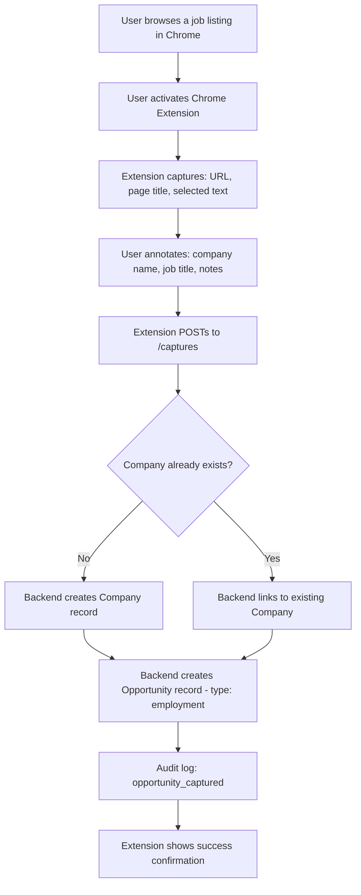
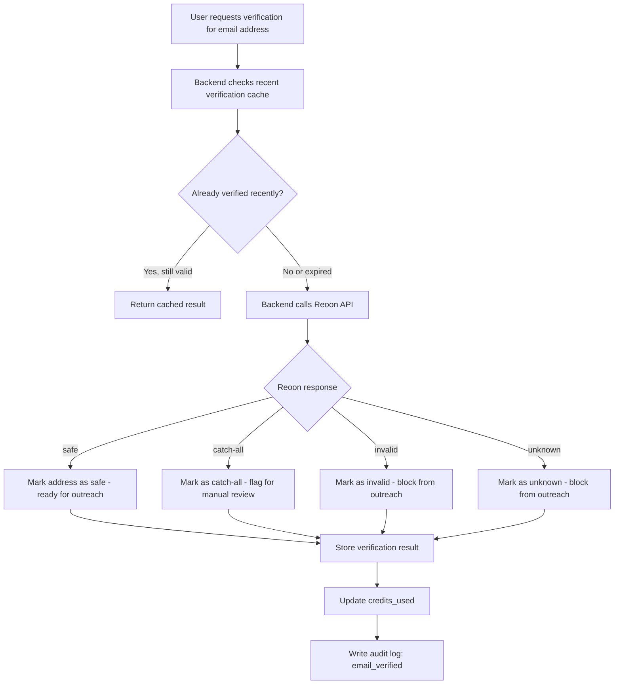
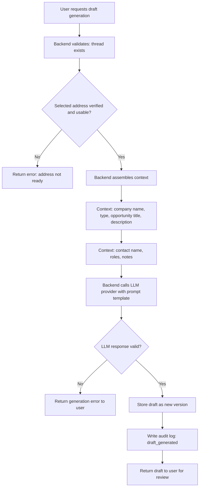
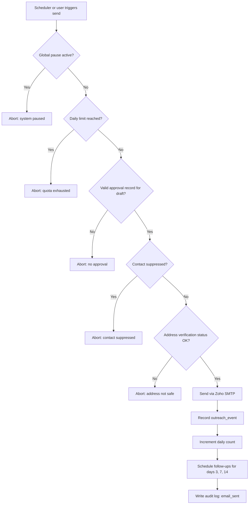
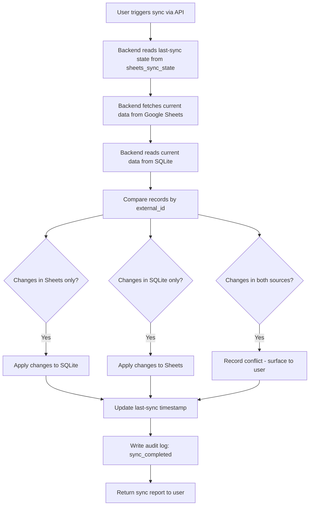

# Workflows — Tandora Lead Management & Outreach Application

## Overview

This document describes the complete user workflows supported by the Tandora application. Each workflow maps to a sequence of API calls, database operations, and user decisions.

Actors:
- **User**: The single human operator of the system.
- **Backend**: The FastAPI application.
- **Extension**: The Chrome Extension.
- **LLM**: Gemini API or Ollama.
- **Reoon**: Reoon Email Verifier API.
- **Zoho**: Zoho SMTP/IMAP services.
- **Sheets**: Google Sheets API.

---

## Workflow 1: Capture a Job Opportunity

**Purpose**: Record a new job opportunity discovered during browser-based research.

**Steps**:
1. User is on a job listing page in Chrome.
2. User activates the extension (keyboard shortcut or toolbar button).
3. Extension captures current URL, page title, and optionally selected text.
4. User reviews the captured data in the extension popup. Can edit company name, job title, and add notes.
5. User submits. Extension POSTs to `POST /api/v1/captures`.
6. Backend searches for an existing company by name (case-insensitive).
7. If found: link the opportunity to the existing company.
8. If not found: create a new Company record.
9. Create an Opportunity record with `type = 'employment'`, `status = 'active'`.
10. Write audit log entry: `opportunity_captured`.
11. Extension receives success response and displays confirmation.

**Result**: A Company and an Opportunity record exist in the database.

---

## Workflow 2: Capture a Freelance Prospect

**Purpose**: Record a company identified as a potential freelance client.

**Steps**:
1. User is on the company's website or LinkedIn page in Chrome.
2. User activates the extension.
3. Extension captures URL, page title, selected text.
4. User annotates: company name, service need description, notes.
5. Extension POSTs to `POST /api/v1/captures` with `opportunity_type = 'freelance_prospect'`.
6. Backend creates or links Company record.
7. Backend creates Opportunity with `type = 'freelance_prospect'`, `status = 'active'`.
8. Write audit log entry: `opportunity_captured`.

**Result**: A Company and freelance Opportunity record exist.

---

## Workflow 3: Capture Decision-Makers

**Purpose**: Add contacts (recruiters, founders, CTOs, hiring managers) to a company.

**Steps**:
1. User identifies a relevant person via LinkedIn, company website, or the job listing.
2. User calls `POST /api/v1/companies/{company_id}/contacts` with:
   - `first_name`, `last_name`
   - `linkedin_url` (if available)
   - `notes`
3. Backend applies deduplication check (see DATABASE_SCHEMA.md § 5.1).
4. If contact already exists: return existing contact ID.
5. If new: create Contact record.
6. User optionally links the contact to a specific opportunity: `POST /api/v1/opportunities/{opportunity_id}/contacts/{contact_id}`.
7. Write audit log entry: `contact_added`.

**Deduplication**: If a contact with the same name already exists at the company, the backend returns the existing record and informs the user.

---

## Workflow 4: Store Multiple Contact Roles

**Purpose**: Record the roles a contact holds (e.g., a person may be both Founder and CTO).

**Steps**:
1. User calls `POST /api/v1/contacts/{contact_id}/roles` with `role` value.
2. Supported role values: `Recruiter`, `Hiring Manager`, `CTO`, `Founder`, `CEO`, `VP Engineering`, `Head of Product`, `Other`.
3. Backend checks for duplicate role (unique constraint: `contact_id + role`).
4. If not duplicate: insert `contact_roles` record.
5. Response includes the full list of roles for the contact.

---

## Workflow 5: Store Multiple Email Addresses

**Purpose**: Associate one or more email addresses with a contact.

**Steps**:
1. User calls `POST /api/v1/contacts/{contact_id}/emails` with `address` and optional `source` and `is_primary` flag.
2. Backend checks the unique constraint on `email_addresses.address`.
3. If the address already exists for a different contact: return a conflict warning (do not silently reassign).
4. If valid: insert `email_addresses` record.
5. If `is_primary = true`, clear `is_primary` on other addresses for the same contact.
6. Response includes all email addresses for the contact.

---

## Workflow 6: Verify Email Addresses via Reoon

**Purpose**: Check the deliverability of a contact's email addresses before outreach.

**Steps**:
1. User calls `POST /api/v1/emails/{email_address_id}/verify`.
2. Backend checks for an existing, non-expired `email_verifications` record for this address.
3. If a valid cached result exists, return it without calling Reoon.
4. Otherwise, call the Reoon API.
5. Store the result in `email_verifications`.
6. If `status = 'catch-all'`, set `catch_all_approved = 0` (requires explicit user approval before use).
7. Record credits consumed.
8. Write audit log entry: `email_verified`.
9. Return the verification result to the user.

**Catch-all approval**: The user must explicitly call `POST /api/v1/emails/{email_address_id}/approve-catchall` to allow use of a catch-all address. This sets `catch_all_approved = 1` and writes an audit log entry.

---

## Workflow 7: Generate Email Drafts

**Purpose**: Use an LLM to generate a personalized email draft for a contact/opportunity pair.

**Steps**:
1. User calls `POST /api/v1/outreach-threads/{thread_id}/drafts/generate`.
2. Backend retrieves the outreach thread, opportunity, company, and contact data.
3. Backend validates that the selected email address has a usable verification status (safe, or catch-all with approval).
4. Backend constructs the LLM prompt using a configured template. Context includes:
   - Company name, website, description
   - Opportunity title and description
   - Contact first name, roles, notes
   - User's professional context (from app config)
5. Backend calls the configured LLM provider (Gemini or Ollama).
6. If generation fails: return error. Do not create a draft record.
7. If successful: create a new `drafts` record. Version is incremented from the last version for this thread + draft_type.
8. Write audit log entry: `draft_generated`.
9. Return draft content (subject + body) with version number.

**Version increment rule**: Each new generation creates version N+1. The highest version is the current draft. Previous versions are retained for audit.

---

## Workflow 8: Approve Email Drafts

**Purpose**: Allow the user to review and approve a draft before it can be sent.

**Steps**:
1. User reviews the draft content (via API response or Google Sheets).
2. User may optionally edit the draft:
   - Call `PUT /api/v1/drafts/{draft_id}` with modified subject/body.
   - Backend creates a new draft version with `is_edited = 1`.
   - The old draft version is retained.
3. User approves the current draft:
   - Call `POST /api/v1/drafts/{draft_id}/approve`.
4. Backend validates: draft exists, belongs to the thread, is the current version.
5. Backend creates an `approvals` record for the draft.
6. Backend updates `outreach_threads.status` to `approved`.
7. Write audit log entry: `draft_approved`.
8. Return approval confirmation.

**Constraint**: Only the current (highest-version) draft for a given thread + draft_type combination may be approved. Approving an older version is rejected.

---

## Workflow 9: Send Approved Emails

**Purpose**: Dispatch an approved email via Zoho SMTP.

**Pre-send checks** (all 10 must pass against persistent database records):
1. A valid approval exists for the exact current draft version (`approvals.draft_id == draft.id`).
2. The global pause flag is disabled (`app_config.sending_paused == 'false'`).
3. The global daily sending quota has not been exceeded (< 20 messages today counted from `outreach_events`).
4. The contact is not suppressed (`contacts.suppressed == 0`).
5. The selected email address is not suppressed (no hard bounce record in `bounces`).
6. The email address meets its verification eligibility requirements (`safe` or approved `catch-all`).
7. Catch-all addresses have separate explicit manual approval (`catch_all_approved == 1`).
8. The recipient is not a duplicate of an already processed outbound message.
9. The outreach thread is still eligible for sending (not suppressed, replied, bounced, or closed).
10. The message content has not changed since approval was granted.

**Steps**:
1. All pre-send checks pass.
2. Backend sends the email via Zoho SMTP, using the approved draft's subject and body.
3. The `Message-ID` header is captured from the SMTP response.
4. Create `outreach_events` record.
5. Increment the daily sent count.
6. Create `followup_schedules` records for days 3, 7, and 14 (relative to today's date).
7. Update `outreach_threads.status` to `sent`.
8. Write audit log entry: `email_sent`.

---

## Workflow 10: Monitor Replies and Bounces

**Purpose**: Detect inbound replies and bounce notifications from the Zoho mailbox.

**Steps** (run on a polling schedule, e.g., every 15 minutes):
1. Backend connects to Zoho IMAP.
2. Fetches unread messages in the inbox and delivery failure folders.
3. For each message, extracts `Message-ID`, `In-Reply-To`, `From`, and `Subject` headers.
4. **Reply detection**: If `In-Reply-To` matches a known `outreach_events.message_id`:
   - Create a `replies` record linked to the outreach thread.
   - Update `outreach_threads.status` to `replied`.
   - Suppress all pending follow-ups for this thread (set `followup_schedules.status = 'suppressed'`, `suppressed_reason = 'reply_received'`).
   - Write audit log: `reply_received`, `followup_suppressed`.
5. **Bounce detection**: If the message is a Delivery Status Notification (DSN):
   - Extract the bounced address from the DSN.
   - Find the matching `email_addresses` record.
   - Create a `bounces` record.
   - Update the `email_addresses` record with a bounce flag.
   - Write audit log: `bounce_detected`.
6. Mark processed messages as read in IMAP.

---

## Workflow 11: Generate and Approve Follow-ups

**Purpose**: Create and approve follow-up emails for threads that have not received a reply.

**Steps**:
1. The scheduler identifies `followup_schedules` records where:
   - `scheduled_date <= today`
   - `status = 'pending'`
   - The parent `outreach_threads.status` is `sent` (not `replied`, `bounced`, or `suppressed`)
2. For each due follow-up, the scheduler triggers draft generation:
   - Calls the LLM with follow-up context (original email summary, follow-up number, days elapsed).
   - Creates a new `drafts` record with `draft_type = 'followup'` and `followup_number`.
   - Updates `followup_schedules.status = 'draft_ready'`.
3. The user is notified (via API query) that follow-up drafts are ready for review.
4. User reviews and approves each follow-up draft independently (same as Workflow 8).
5. Once approved, the follow-up is dispatched on the next scheduler run (same pre-send checks as Workflow 9).
6. Write audit log: `followup_sent`.

**Rule**: If a reply is received between follow-up generation and approval, the follow-up must be suppressed before sending.

---

## Workflow 12: Synchronize Google Sheets

**Purpose**: Manually sync data between the SQLite database and a configured Google Sheets spreadsheet.

**Steps**:
1. User calls `POST /api/v1/sync/sheets`.
2. Backend reads `sheets_sync_state` for each entity type.
3. Backend fetches rows from configured Google Sheets tabs.
4. Backend fetches corresponding records from SQLite (matched by `external_id` or `sheets_row_id`).
5. For each record:
   - **New in Sheets, not in SQLite**: Create in SQLite.
   - **New in SQLite, not in Sheets**: Create in Sheets.
   - **Changed in Sheets only** (Sheets `updated_at` > `last_sync_at`): Apply to SQLite.
   - **Changed in SQLite only** (SQLite `updated_at` > `last_sync_at`): Apply to Sheets.
   - **Changed in both**: Record as a conflict. Do not auto-resolve. Surface to user.
6. Update `sheets_sync_state.last_sync_at` for each entity type.
7. Write audit log entry: `sync_completed`.
8. Return a sync report: records created, updated, conflicted.

**Idempotency**: Running sync twice without any changes in between must produce zero creates, zero updates, and zero conflicts.

**Conflict resolution**: The user is presented with conflicting records and must choose which version wins. This is a separate API call: `POST /api/v1/sync/resolve-conflict`.
